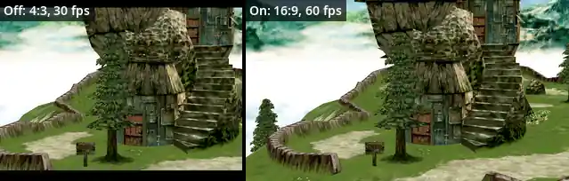
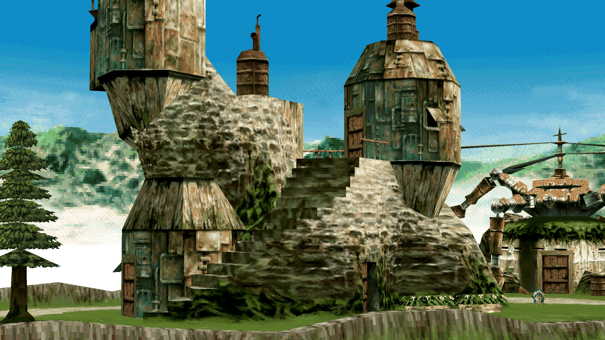
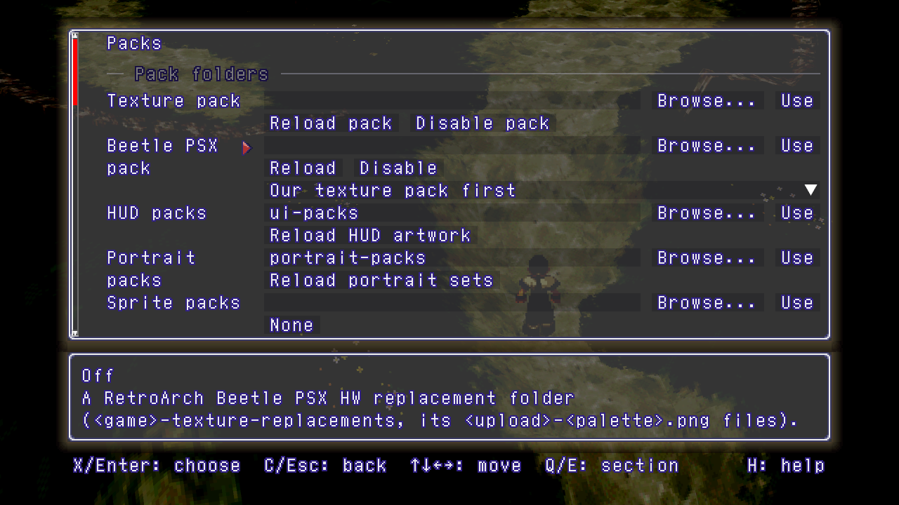
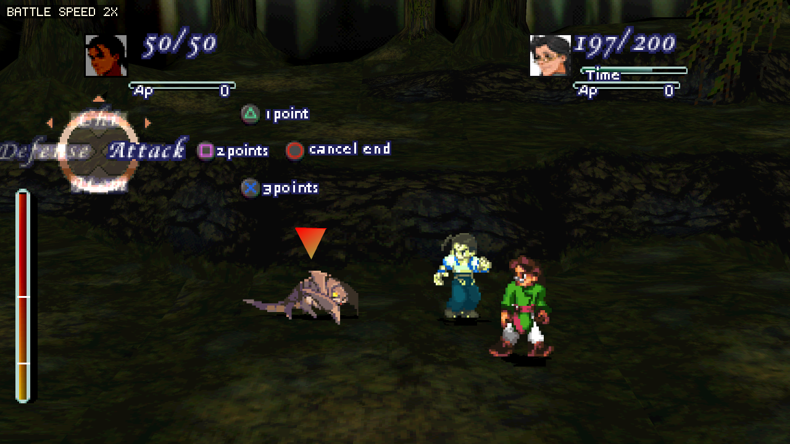
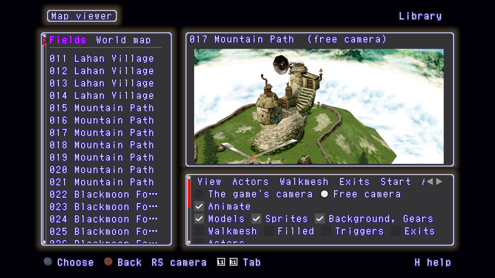

[English](README.md) | 日本語

# ゼノギアス PC 移植版

**オリジナルのゲームロジックが、PC でネイティブに動く。**

ビルドすると製品版と 1 バイト単位で一致する[マッチング逆コンパイル](https://github.com/EtherAura/xenogears)から作っています。Linux、Windows、FreeBSD、Android でネイティブに動き、画面、ゲームプレイ、演出の追加機能を好みで使えます。**-Project Exodus-** の一部です。

[**ウェブサイト**](https://exodus.agartha.digital/) · [**ビルドとセットアップ**](docs/building-ja.md) · [**Android**](docs/android-ja.md) · [**画面**](docs/display-ja.md) · [**パック**](docs/packs-ja.md) · [**ゲームプレイ**](docs/gameplay-ja.md) · [**おまけ**](docs/extras-ja.md)

## PC でゼノギアスを最初から最後まで

Linux と Windows の両方で、ディスク 1 とディスク 2 のどちらにも対応しています。メインストーリーはニューゲームからスタッフロールまで遊べる見込みです。また、現在のリリースでは、終盤で起きることが知られていたフリーズを標準で修正しています。

北米版か日本版の PlayStation ディスクイメージは、ご自身でご用意ください。スタッフロールまでたどり着いたら、どのプラットフォームで、どの地域版のディスクで遊んだかをぜひ教えてください。

[**Xenogears PC をダウンロード**](https://github.com/EtherAura/xenogears-pc/releases/latest)

| [画面](docs/display-ja.md) | [パック](docs/packs-ja.md) |
|---|---|
|  |  |
| [**ゲームプレイ**](docs/gameplay-ja.md) | [**おまけ**](docs/extras-ja.md) |
|  |  |

移植版はゲームデータをお手元のディスクイメージから読み込みます。ゲームデータは何も同梱していません。追加機能はすべて任意で、標準設定では PlayStation 版の見た目と演出を保ちます。GitHub の CI ではゲームデータを必要としない検査だけを行い、完全なビルドと製品版との照合はローカルで行います。

## 対応プラットフォーム

- **Linux x86-64 と Windows x64。** [ダウンロード](https://github.com/EtherAura/xenogears-pc/releases/latest)を公開しています。
- **FreeBSD 15 amd64。** 北米版と日本版のディスクに対応し、オリジナルエンジンと強化エンジンを含む[ネイティブパッケージ](https://github.com/EtherAura/xenogears-pc/releases/tag/v2026.11.20-freebsd)があります。ソフトウェア Vulkan を使う VM 上の FreeBSD 15.1 amd64 で、インストールと起動を確認しました。
- **Android 13 以降、arm64 と x86-64。** すべての[リリース](https://github.com/EtherAura/xenogears-pc/releases/latest)に、それぞれ向けの署名済み APK があります。どちらを使うかとインストール方法は [Android のページ](docs/android-ja.md)にあります。Pixel 10 Pro XL（arm64）と Android 17 x86-64 のエミュレーターでテストしました。

[開発への参加](CONTRIBUTING.ja.md) · [セキュリティ](SECURITY.ja.md) · [ディスカッション](https://github.com/EtherAura/xenogears-pc/discussions)

本プロジェクトの成果物: GPL-3.0 以降。サードパーティのライブラリはそれぞれのライセンスに従います。Xenogears © Square Enix。非公式であり、権利者とは関係ありません。
