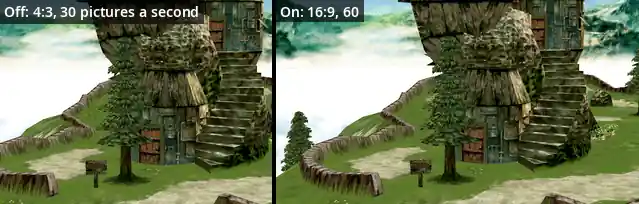
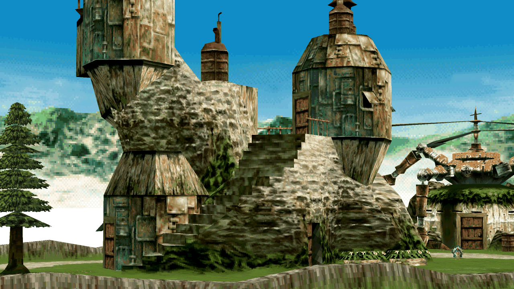
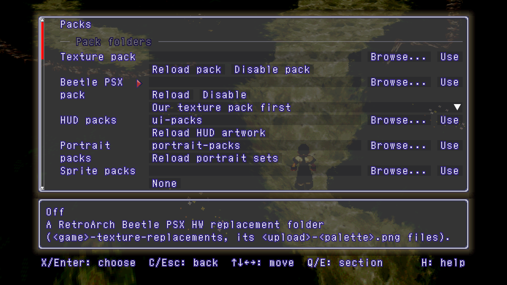
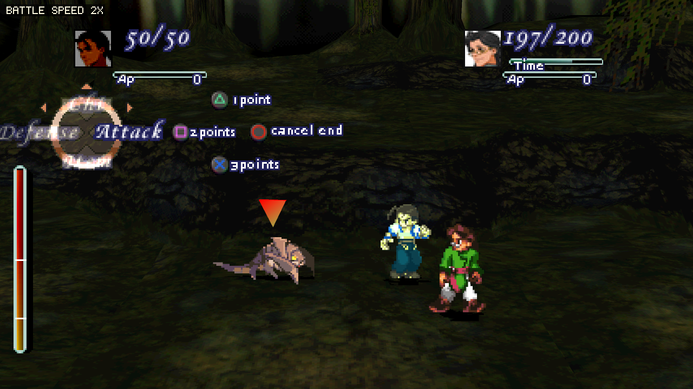
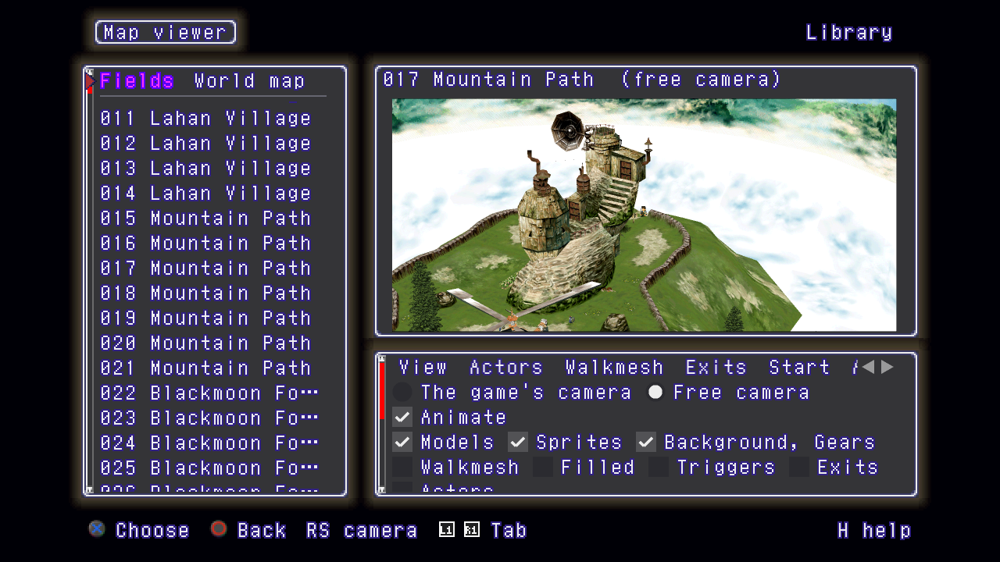

# Xenogears PC port

**The original game logic. A native PC home.**

Built from the [matching decompilation](https://github.com/EtherAura/xenogears).
Native Linux and Windows, with optional display, gameplay and presentation extras.
Part of **-Project Exodus-**.

[**Build and set up**](docs/building.md) · [**Display**](docs/display.md) · [**Packs**](docs/packs.md) · [**Gameplay**](docs/gameplay.md) · [**Extras**](docs/extras.md)

| [Display](docs/display.md) | [Packs](docs/packs.md) |
|---|---|
|  |  |
| [**Gameplay**](docs/gameplay.md) | [**Extras**](docs/extras.md) |
|  |  |

**Bring your own US or Japanese discs.** The port reads game data from your images; none is included.
The extras are optional, and default settings preserve the PlayStation presentation.
GitHub CI covers checks that need no game data; full builds and retail checks run locally.

[Contributing](CONTRIBUTING.md) · [Security](SECURITY.md) · [Discussions](https://github.com/EtherAura/xenogears-pc/discussions)

Project work: GPL-3.0 or later; third-party libraries retain their licences. Xenogears © Square Enix. Unofficial and unaffiliated.
