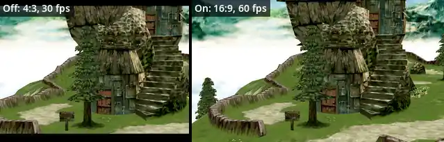
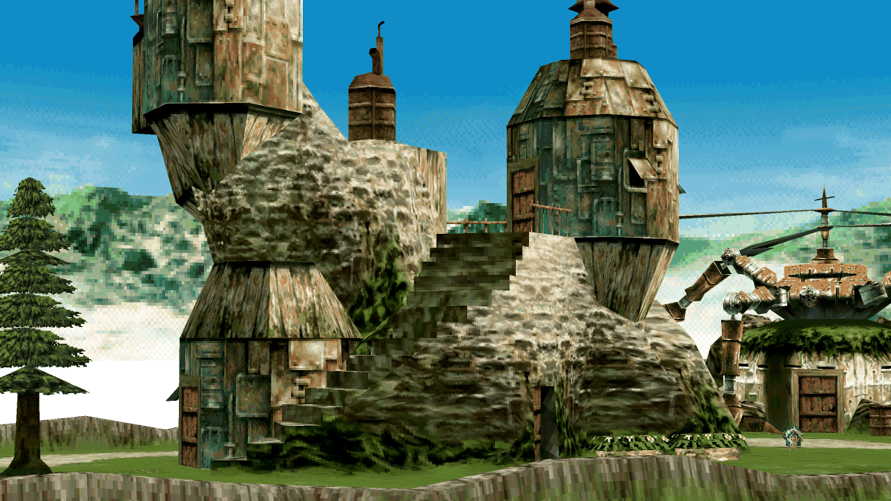
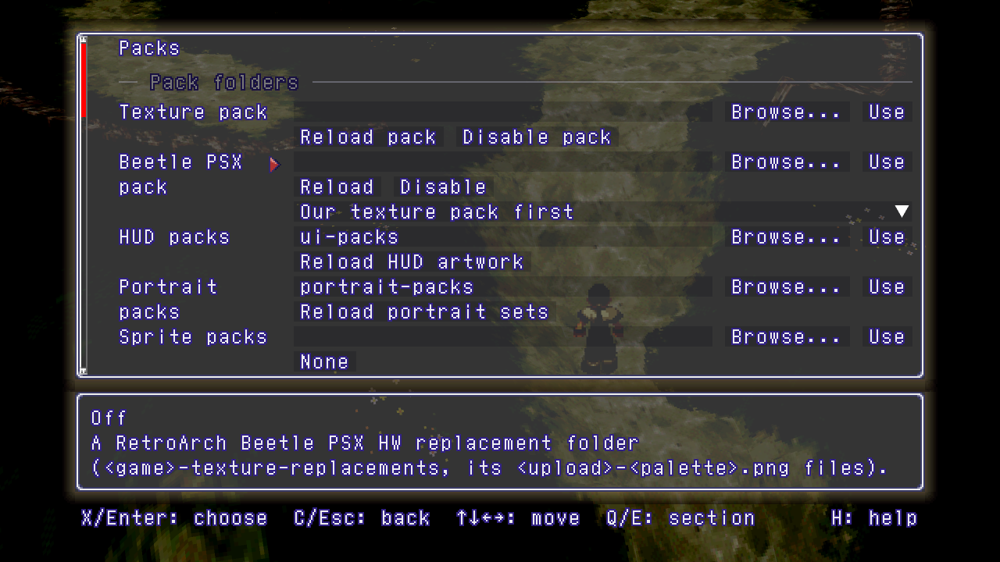
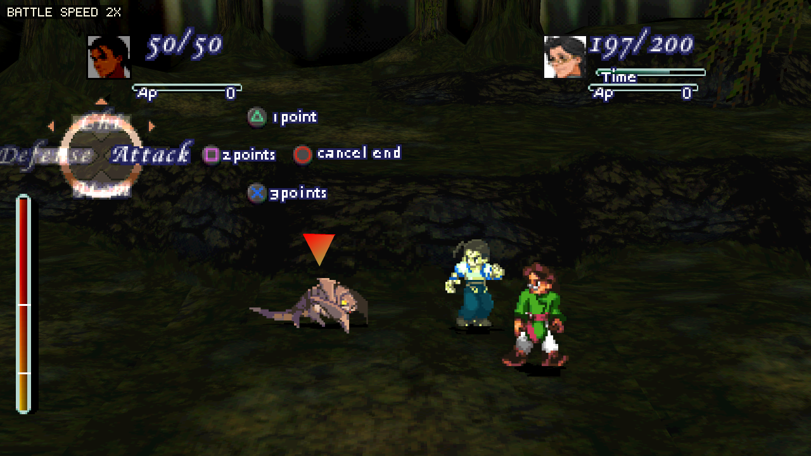
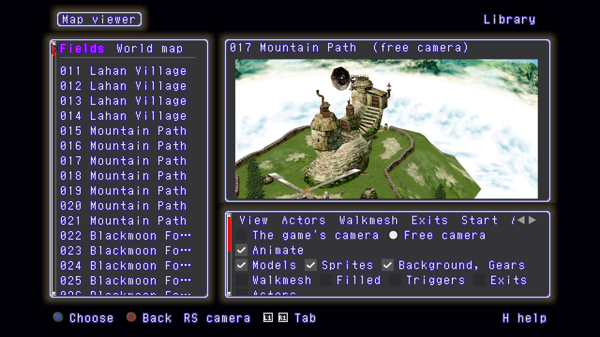

English | [日本語](README.ja.md)

# Xenogears PC port

**The original game logic. A native PC home.**

Built from the [matching decompilation](https://github.com/EtherAura/xenogears).
Native Linux, Windows, FreeBSD and Android, with optional display, gameplay and presentation extras.
Part of **-Project Exodus-**.

[**Website**](https://exodus.agartha.digital/) · [**YouTube**](https://www.youtube.com/@XG-ProjectExodus) · [**Build and set up**](docs/building.md) · [**Android**](docs/android.md) · [**Display**](docs/display.md) · [**Packs**](docs/packs.md) · [**Gameplay**](docs/gameplay.md) · [**Extras**](docs/extras.md)

## Start your full Xenogears playthrough on PC

Both discs are supported on Linux and Windows. We expect the main story to be playable from New Game through the credits, and the current release fixes a known late-game freeze by default.

Bring your own US or Japanese PlayStation disc images. If you reach the credits, we’d love to hear which platform and disc region you played.

[**Download Xenogears PC**](https://github.com/EtherAura/xenogears-pc/releases/latest)

| [Display](docs/display.md) | [Packs](docs/packs.md) |
|---|---|
|  |  |
| [**Gameplay**](docs/gameplay.md) | [**Extras**](docs/extras.md) |
|  |  |

The port reads game data from your images; none is included.
The extras are optional, and default settings preserve the PlayStation presentation.
GitHub CI covers checks that need no game data; full builds and retail checks run locally.

**Original work.** The port's code was written for this project, with AI assistance (Claude), from documented hardware behaviour and our own measurements, and the game logic is the C of the [decompilation](https://github.com/EtherAura/xenogears). Emulators and other projects were references for facts only: we ran them and compared what came out, and none of their code, tables or constants went into the port. The libraries in `port/third_party/` keep their own licences.

## Platforms

- **Linux x86-64 and Windows x64.** [Public downloads](https://github.com/EtherAura/xenogears-pc/releases/latest) are available.
- **FreeBSD 15 amd64.** [Native package](https://github.com/EtherAura/xenogears-pc/releases/tag/v2026.11.20-freebsd) with Original and Enhanced engines for US and Japanese discs. Install and launch passed on FreeBSD 15.1 amd64 in a VM with software Vulkan.
- **Android 13 or later, arm64 and x86-64.** Every [release](https://github.com/EtherAura/xenogears-pc/releases/latest) has a signed APK for each; the [Android page](docs/android.md) says which to take and how to install it. Tested on a Pixel 10 Pro XL (arm64) and in an Android 17 x86-64 emulator.
- **Updates.** Releases can check for new ones, only if you allow it when first asked, and install them where the app owns its files; the `.deb` has an APT repository. See [Updates](docs/building.md#updates).

[Contributing](CONTRIBUTING.md) · [Security](SECURITY.md) · [Code of conduct](CODE_OF_CONDUCT.md) · [Discussions](https://github.com/EtherAura/xenogears-pc/discussions)

Project work: GPL-3.0 or later; third-party libraries retain their licences. Xenogears © Square Enix. Unofficial and unaffiliated.
