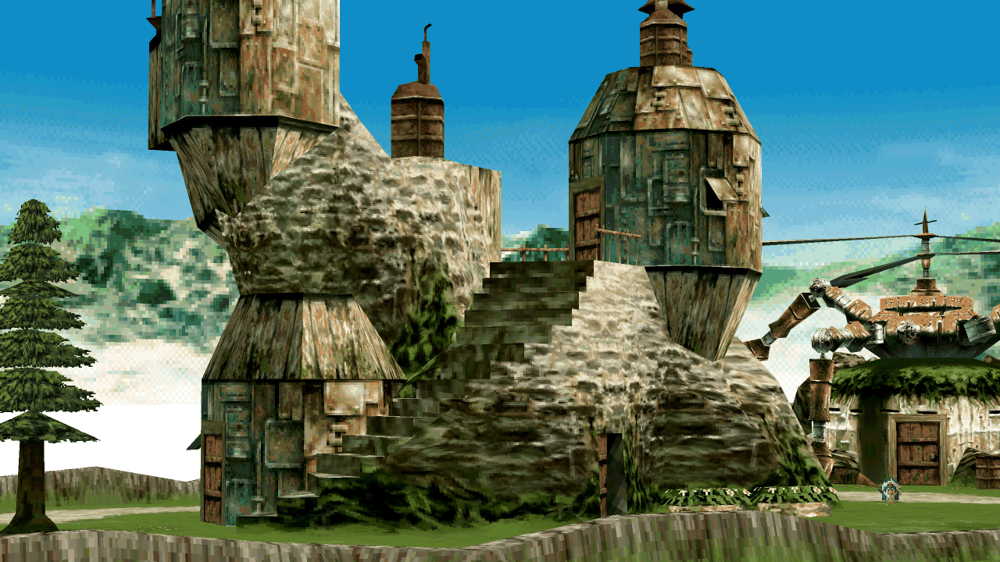

[English](Home.md) | 日本語

# ゼノギアス PC 移植版

非公式のゼノギアス保存活動、-Project Exodus- の一部です。

Linux、Windows、FreeBSD でネイティブに動くゼノギアスです。Android 版も開発中です。ビルドすると製品版と 1 バイト単位で一致する[マッチング逆コンパイル](https://github.com/EtherAura/xenogears)から作っているので、ゲームロジックは元のコードを PC 向けにコンパイルしたものです。北米版か日本版のディスクは、ご自身でご用意ください。ゲームのデータは何も同梱しておらず、移植版は起動するたびにお手元のディスクイメージからデータを読み込みます。

オリジナルにない機能はすべて任意です。標準設定のままなら、PlayStation 版と同じように遊べます。

## ページ

| ページ | 内容 |
|---|---|
| [ビルド](building-ja.md) | 必要なもの、ビルド手順、初回起動、強化エンジン、Windows 版のビルド |
| [Android](android-ja.md) | APK のインストール: 署名の確認、ディスクのフォルダー、開発者の確認 |
| [画面](display-ja.md) | ワイド画面、高解像度とフィルター、なめらかな動き、パフォーマンス表示 |
| [ゲームプレイ](gameplay-ja.md) | 戦闘速度、バトル、ステートセーブと巻きもどし、操作とサウンド |
| [翻訳](translations-ja.md) | 翻訳されたゲームテキストの選び方と、各ディスクで動作したファンパッチ |
| [パック](packs-ja.md) | テクスチャ、スプライト、テキスト、顔グラフィックの差し替え: 選び方、入れ方、作り方 |
| [おまけ](extras-ja.md) | ジュークボックス、モンスター一覧、ギャラリー、モデルビューアーとマップビューアー |

## リポジトリ内のファイル

- [README](../README.ja.md): 概要。
- [CONTRIBUTING](../CONTRIBUTING.ja.md): バグの報告、変更が通るべき検査、プルリクエストの扱い。
- [SECURITY](../SECURITY.ja.md): 脆弱性の報告方法。

## ライセンス

ライセンスは GPL-3.0 以降です（[LICENSE](../LICENSE)）。`port/third_party/` 内のライブラリは、それぞれのライセンスに従います。ゼノギアスの著作権はスクウェア・エニックスにあります。本プロジェクトは同社と関係がなく、ゲームデータも同梱していません。
