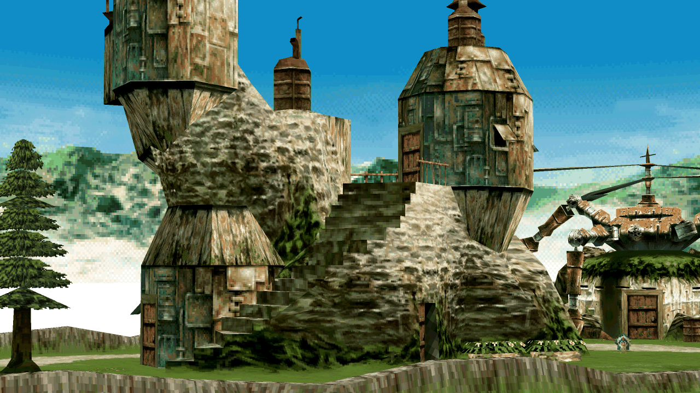

# Xenogears PC port

Part of -Project Exodus-, an unofficial Xenogears preservation effort.

Xenogears running natively on Linux and Windows. It is built from the
[matching decompilation](https://github.com/EtherAura/xenogears), so the game
logic is the original code, compiled for the PC. Bring your own US or Japanese
discs: nothing from the game is included, and the port reads its data from your
disc image every time it starts.

Everything beyond the original is optional. With the default settings it plays
like the PlayStation version.

## Pages

| page | what it covers |
|---|---|
| [Building](building.md) | What you need, the build steps, the first start, the Enhanced engine and the Windows build |
| [Display](display.md) | Widescreen, higher resolutions and filters, smoothed motion, the performance overlay |
| [Gameplay](gameplay.md) | Battle speed, battles, save states and rewind, controls and audio |
| [Packs](packs.md) | Replacement textures, sprites, text and portraits: choosing, installing and making them |
| [Extras](extras.md) | Jukebox, bestiary, gallery, model and map viewers |

## In the repository

- [README](../README.md): the overview.
- [CONTRIBUTING](../CONTRIBUTING.md): reporting a bug, what a change has to pass, and how a pull request is handled.
- [SECURITY](../SECURITY.md): how to report a vulnerability.

## Licence

GPL-3.0 or later, in [LICENSE](../LICENSE). The libraries in `port/third_party/`
keep their own licences. Xenogears is © Square Enix. This project isn't
affiliated with them, and no game data is included.
