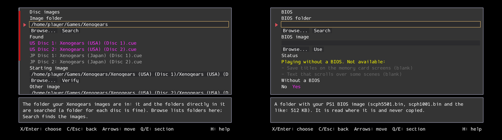

[English](building.md) | 日本語

# ビルド方法

移植版は、お手持ちのディスクを使ってソースからビルドします。実行ファイルにはゲームのデータが含まれていません。起動するたびにディスクイメージからゲームを読み込むため、そのビルドが対象とする版のディスクイメージが必要です。

## 必要なもの

- bash、curl、tar、git、make、gcc、cpp、Python 3、Ninja、CMake 3.25 以降が入った Linux x86-64。
- C と C++ のコンパイラー、SDL 3、Vulkan のヘッダー、`glslc`。
- Vulkan 1.3 に対応した GPU とドライバー。
- 任意: Khronos glslang（シェーダープリセット用）と dav1d（AV1 のムービーパック用）。
- Redump 形式の `.cue`/`.bin` イメージにしたお手持ちのディスク: 北米版（SLUS-00664）または日本版（SLPS-01160）。

root 権限は不要です。`tools/setup.sh` が PS1 のツールチェーンを `tools/toolchain` に、Python のパッケージを `.venv` に入れます。

## 手順

```bash
tools/setup.sh
source .venv/bin/activate      # fish: source .venv/bin/activate.fish
```

イメージは Redump の名前のまま、ディスクごとにフォルダーを分けて `bin/` の下に置きます。

```
bin/Xenogears (USA) (Disc 1)/Xenogears (USA) (Disc 1).cue + .bin
bin/Xenogears (USA) (Disc 2)/Xenogears (USA) (Disc 2).cue + .bin
```

ビルドに必要なのはディスク 1 だけです。続けて次を実行します。

```bash
python tools/extract.py us     # the game's code files, checked against retail
python tools/configure.py us   # split them and write build.ninja
ninja                          # rebuild every module and check it byte for byte
python tools/pc_sources.py     # source lists for CMake
cmake -S port -B build/pc/release -G Ninja -DCMAKE_BUILD_TYPE=Release -DXG_VERSION=US -DXG_EXTRAS=ON
cmake --build build/pc/release
build/pc/release/xenogears --setup
```

日本版では `jp` と `-DXG_VERSION=JP` を使い、専用のビルドフォルダー（例: `build/pc/release-jp`）に分けてビルドします。

## 初回起動



`--setup` を付けるとセットアップ画面が開きます。イメージを入れたフォルダー（両方のディスクを見つけます）と、必要なら PS1 の BIOS を選びます。BIOS がなくても、空欄のままになるのはメモリーカード画面のセーブ名と一部のスクロールする文字だけです。2 回目以降の起動では、保存したパスが使われます。

設定、メモリーカード、ステートセーブは `~/.local/share/xenogears/`（Windows では `%APPDATA%\xenogears\`）に保存されます。

## 強化エンジン

`-DXG_ENGINE=enhanced` を付けると、強化エンジンが `xenogears-enhanced` としてビルドされます。`build/pc/enhanced` にビルドするか `xenogears` と同じ場所に置けば、**F1 → システム（System） → Engine** で 2 つを切り替えられます。

## Windows

上の手順のあと、`tools/build_windows.sh [--jp] [--debug] [OUTDIR]` を使うと MinGW-w64 で Windows 向けにクロスビルドできます。必要なのは `x86_64-w64-mingw32-gcc`、CMake、Ninja、`glslc` と、3 つのソースの tarball です。tarball は SDL 3 と、シェーダープリセットとムービーパックの AV1 動画に使う glslang と dav1d（Meson）です。それぞれのバージョン、URL、SHA-256 は `tools/deps.json` にあります。`python tools/deps.py fetch` はこれらを `tools/toolchain-src` にダウンロードし、SHA-256 が一致したファイルだけを残します。ビルドそのものは何もダウンロードしません。`--dist` を付けると配布用のビルドになり、実行ファイルにビルドしたマシンのパスが残りません。成果物は標準で `build/pc/dist/xenogears-us-windows-x86_64` に作られ、`xenogears.exe`、`xenogears-enhanced.exe`、`SDL3.dll` が入ります。

## デスクトップ向けリリースパッケージ

Linux x86-64 のホストでは、リリースを作るコマンドが bubblewrap、MinGW-w64、Meson、CMake、Ninja、`glslc`、Vulkan のヘッダーを使います。キャッシュする Ubuntu のビルド環境と NSIS コンパイラーの準備には Docker を使います。

```bash
bash build-release.sh --fetch-only --cache release-cache
bash build-release.sh --discs bin --cache release-cache --version YYYY.MM.N --out release
```

2 つ目のコマンドは北米版ディスク 1 のイメージを使い、オフラインでビルドします。中身の検査に通ると、Windows のインストーラーと ZIP、Linux の tarball、Ubuntu amd64 の `.deb` を書き出します。tarball と Windows のパッケージには両方のエンジンが、`.deb` にはオリジナルエンジンが入ります。

## ディスクなしでのビルド

リリースの Linux 向け実行ファイルは、ディスクのないマシンでもビルドし直せます。各リリースにはリンク用の表 `xenogears-pc-VERSION-link-tables.tar.gz` が付いています。そのリリースのタグをチェックアウトし、このファイルをダウンロードして、次を実行します。

```bash
bash build-release.sh --tables xenogears-pc-VERSION-link-tables.tar.gz --out release
```

必要なのは bubblewrap と、キャッシュする Ubuntu のビルド環境を一度だけ準備するための Docker（とネットワーク接続）です。ビルドそのものはオフラインで行います。表にあるのはゲームのデータのアドレス、サイズ、オフセット、ハッシュだけで、データそのものは入っていません。どちらの方法でも同じ実行ファイルができ、起動のたびにお手持ちのディスクからゲームを読み込みます。

表は、リリースをビルドする場所で、ディスクから、リリースのビルド環境（`packaging/deb_ubuntu.Dockerfile`。ダイジェストで指定したベースイメージと、Ubuntu のアーカイブのスナップショット 1 つ）のコンパイラーで作ったものです。表には、そのビルドが作って検査した各実行ファイルの SHA-256 も添えてあります。そのリリースのソースであれば、同じバイト列ができなければコマンドは失敗します。`--reproduce` を付けると、ソースが表のものと違う場合も失敗します。パッケージは作りません。パッケージの中身の検査にはディスクイメージが必要だからです。Windows 向けの実行ファイルは、まだこの方法ではビルドできません。リポジトリのワークフロー「Build without a disc」は、リリースごとにこれを実行し、結果をそのリリースの Linux 向けパッケージと比べます。

チェックアウトに `asm/` フォルダーがなく、表を `port/link-tables` に展開してあれば、通常の CMake のビルドも表からリンクします（`-DXG_LINK_FROM=tables` で指定できます）。表はビルド環境のコンパイラーに合わせてあるので、別のコンパイラーがオブジェクトのデータを違う並びに置いたところで、ビルドは古いソースデータ計画（stale plan）として止まります。

ディスクがある場合は、`bash build-release.sh --discs bin --write-tables port/link-tables` で自分のチェックアウトに合った表を書き出せます。このコマンドは両方のエンジンをビルドして検査するだけで、パッケージは作りません。
