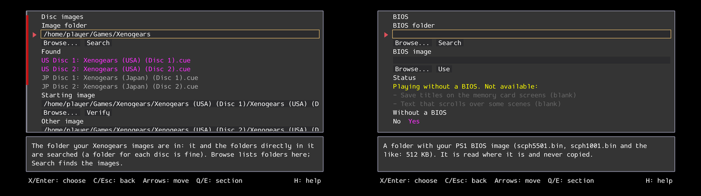

English | [日本語](building-ja.md)

# Building

The port is built from source with your own discs. The executable carries no
game data: at every start it reads the game from your disc image, which must
be the release the build was made for.

## Requirements

- Linux x86-64 with bash, curl, tar, git, make, gcc and cpp, Python 3, Ninja
  and CMake 3.25 or newer.
- A C and C++ compiler, SDL 3, the Vulkan headers and `glslc`.
- A GPU and driver with Vulkan 1.3.
- Optional: Khronos glslang (shader presets) and dav1d (AV1 movie packs).
- Your discs as Redump `.cue`/`.bin` images: US (SLUS-00664) or Japanese
  (SLPS-01160).

No root access is needed. `tools/setup.sh` puts the PS1 toolchain in
`tools/toolchain` and the Python packages in `.venv`.

## Steps

```bash
tools/setup.sh
source .venv/bin/activate      # fish: source .venv/bin/activate.fish
```

Put the images under `bin/` with their Redump names, a folder per disc:

```
bin/Xenogears (USA) (Disc 1)/Xenogears (USA) (Disc 1).cue + .bin
bin/Xenogears (USA) (Disc 2)/Xenogears (USA) (Disc 2).cue + .bin
```

Only disc 1 is needed to build. Then:

```bash
python tools/extract.py us     # the game's code files, checked against retail
python tools/configure.py us   # split them and write build.ninja
ninja                          # rebuild every module and check it byte for byte
python tools/pc_sources.py     # source lists for CMake
cmake -S port -B build/pc/release -G Ninja -DCMAKE_BUILD_TYPE=Release -DXG_VERSION=US -DXG_EXTRAS=ON
cmake --build build/pc/release
build/pc/release/xenogears --setup
```

For the Japanese release use `jp` and `-DXG_VERSION=JP`, in its own build
folder (for example `build/pc/release-jp`).

## First start



`--setup` opens the setup screen. Choose the folder with your images (it
finds both discs) and, optionally, a PS1 BIOS. Without a BIOS only the save
names on the memory card screens and some scrolling text stay blank. Later
starts use the saved paths.

Settings, memory cards and save states are kept in
`~/.local/share/xenogears/` (Windows: `%APPDATA%\xenogears\`).

## Enhanced engine

`-DXG_ENGINE=enhanced` builds the Enhanced engine as `xenogears-enhanced`.
Build it into `build/pc/enhanced`, or put it beside `xenogears`, and F1 >
System > Engine switches between the two.

## Windows

After the steps above, `tools/build_windows.sh [--jp] [--debug] [OUTDIR]`
cross-builds for Windows with MinGW-w64. It needs `x86_64-w64-mingw32-gcc`,
CMake, Ninja, `glslc` and three source tarballs: SDL 3, and for the shader
presets and the movie packs' AV1 videos, glslang and dav1d (Meson). Their
versions, URLs and SHA-256 sums are in `tools/deps.json`;
`python tools/deps.py fetch` downloads them into `tools/toolchain-src` and
keeps only files whose sum matches. The build itself downloads nothing.
`--dist` makes a build to hand out, with no path of the build machine in its
executables. The result, in `build/pc/dist/xenogears-us-windows-x86_64` by
default, holds `xenogears.exe`, `xenogears-enhanced.exe` and `SDL3.dll`.

## Desktop release packages

On a Linux x86-64 host, the release command uses bubblewrap, MinGW-w64,
Meson, CMake, Ninja, `glslc` and the Vulkan headers. Docker is used to
prepare the cached Ubuntu build environment and NSIS compiler.

```bash
bash build-release.sh --fetch-only --cache release-cache
bash build-release.sh --discs bin --cache release-cache --version YYYY.MM.N --out release
```

The second command uses the US Disc 1 image and builds offline. It writes
the Windows installer and ZIP, the Linux tarball and the Ubuntu amd64
`.deb` once their payload audits pass. The tarball and Windows packages
include both engines. The `.deb` includes Original.
