[English](display.md) | 日本語

# 画面表示

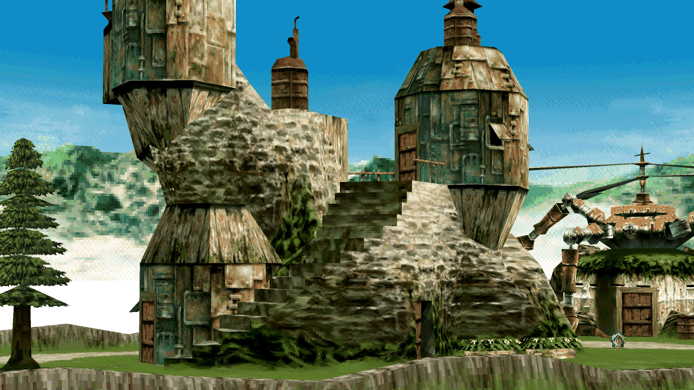

16:9、PS1 の 6 倍の解像度、縦の表示範囲（Vertical framing）を拡張（Expanded）にしたラハン村。

F1 で設定メニューが開きます（ゲームパッドでは Guide ボタン、または左右のスティックの同時押し込み）。変更はすぐに反映され、`settings.ini` に保存されます。

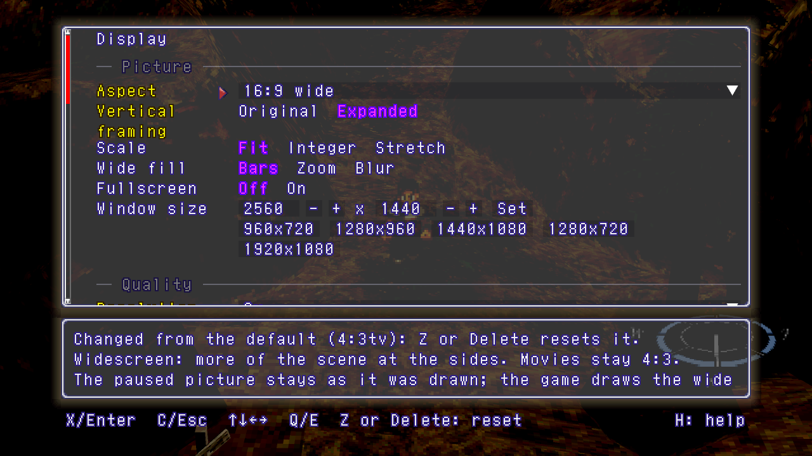

## ワイド画面

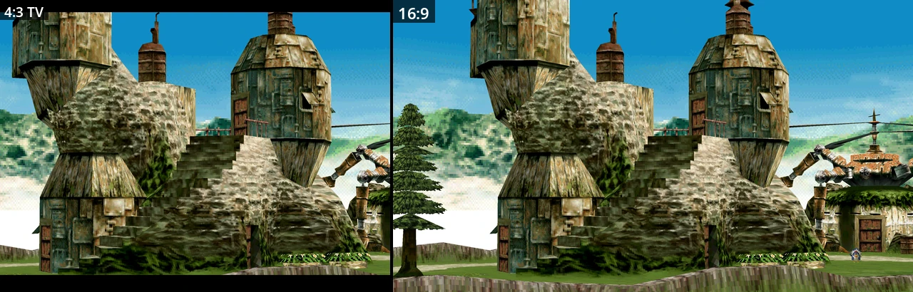

4:3 テレビ（4:3 TV）と 16:9。ワイドのアスペクト比では、場面の左右がより広く描かれます。**F1 → 画面（Display） → アスペクト比（Aspect）**（F3 キーでも可）。

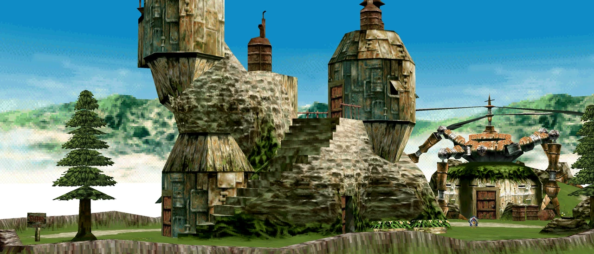

21:9。アスペクト比にはほかに、4:3 全体（4:3 fill）、1:1 正方形ピクセル（1:1 square pixels）、16:10、32:9、カスタム 横:縦（custom w:h）があります。

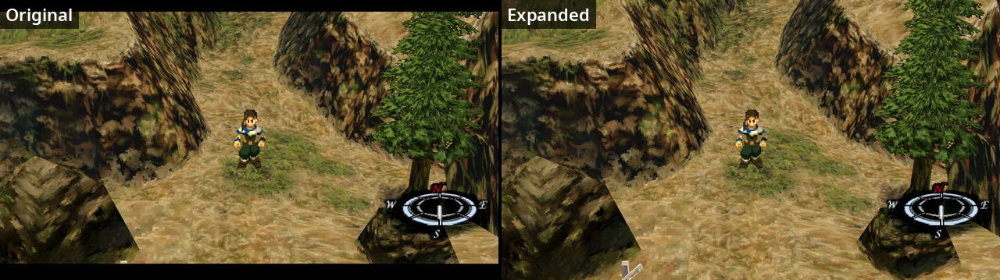

拡張は、フィールド、バトル、ワールドマップで、ゲームが画面の上下に黒く空けているラインまで描きます。**F1 → 画面 → 縦の表示範囲**。

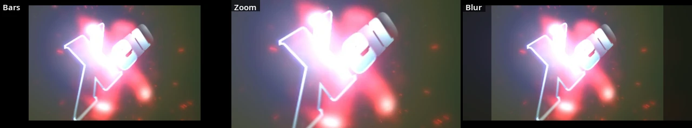

ムービーは 4:3 のままです。ワイドの余白（Wide fill）は、その左右に黒帯、拡大した映像、ぼかした映像のいずれかを置きます。**F1 → 画面 → ワイドの余白**（F6 キーでも可）。

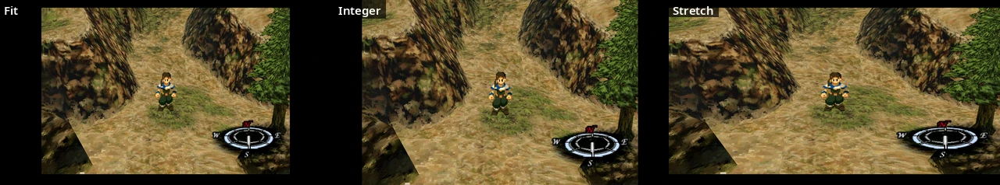

フィット（Fit）、整数倍（Integer）、引き伸ばし（Stretch）。ここでは 16:9 のウィンドウに 4:3 の画像を表示しています。**F1 → 画面 → 拡大方法（Scale）**（F4 キーでも可）。

## 解像度とフィルター

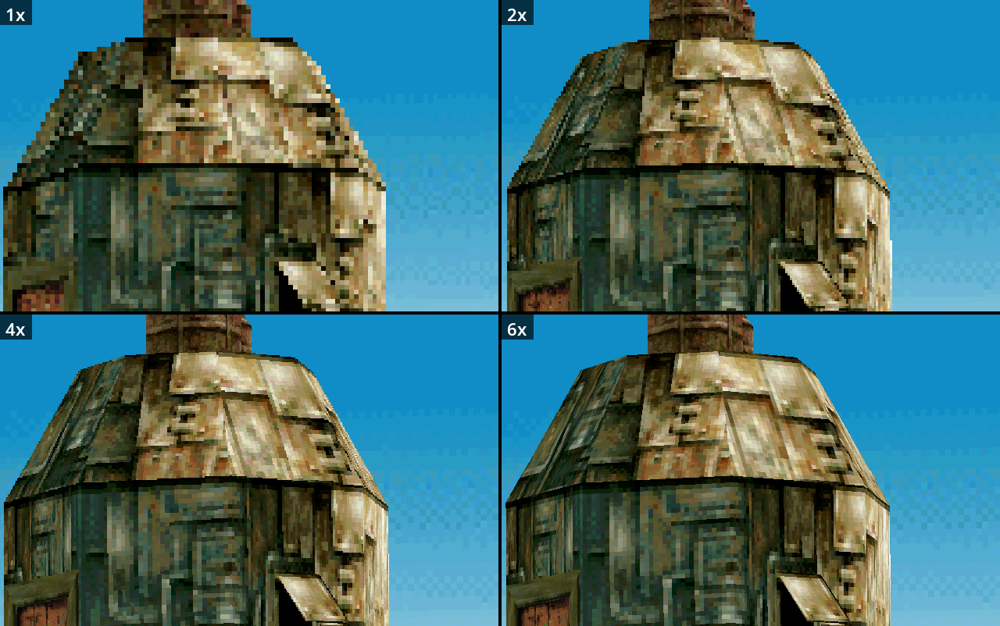

ゲームを本来の解像度の 1x〜12x、または自動（Auto。ウィンドウの高さから決まります）で描きます。ゲーム自体は内部で 1x の画像のまま動いています。**F1 → 画面 → 解像度（Resolution）**（Shift+F4 キーで 1x と切り替え）。

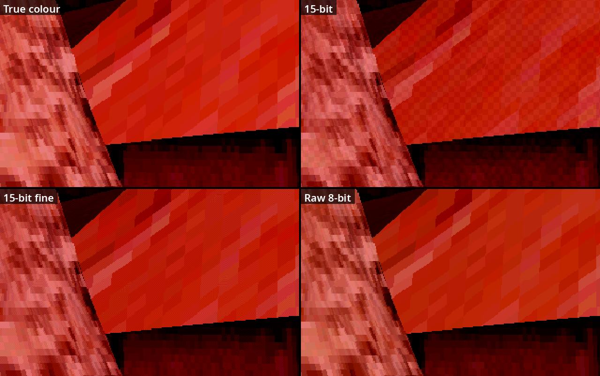

1x より上では、トゥルーカラー（True colour）は PS1 のディザをなくし、15 ビット（15-bit）はディザを PS1 の大きさのまま残し、15 ビット(細かい)（15-bit fine）は高い解像度の細かさで残します。**F1 → 画面 → 色（Colour）**。

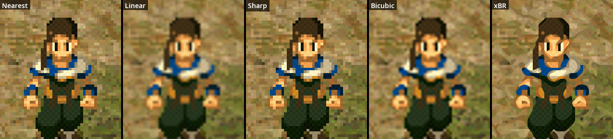

画像をウィンドウに合わせて拡大する方法です。ニアレスト（Nearest）、リニア（Linear）、シャープ（Sharp）、バイキュービック（Bicubic）、xBR(縁) から選びます。**F1 → 画面 → フィルター（Filter）**（F5 キーでも可）。

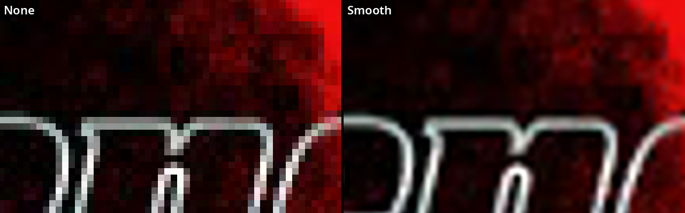

ムービーには専用のフィルターとシェーダーを設定できます。Smooth (built in) は、ムービーのブロックの境目をなめらかにします。**F1 → 画面 → ムービー（Movies）、ムービーのシェーダー（Movie shader）**。シェーダー（Shader）には、画面全体にかける RetroArch の `.slangp` か `.slang` のプリセットを指定します。

## ピントの奥行き（被写界深度）

フィールド、戦闘、ワールドマップで、パーティーより奥と手前の背景がやわらかくぼけます。キャラクター、会話、顔グラフィック、HUD はくっきりしたままです。HD-2D 風の見た目の最初の一部で、変わるのは画像の見せ方だけです。ゲーム自体は元の画像のまま動いています。強化エンジン専用です（**F1 → システム（System） → Engine**）。**F1 → 画面 → ピントの奥行き（Depth of field）**（オフ（Off）、弱（Subtle）、中（Medium）、強（Strong））と、**ピントの合う範囲（Focus range）**（せまい（Narrow）、ノーマル（Normal）、広い（Wide）。パーティーの周りでピントが合う奥行きの広さです）で設定します。

## ティルトシフト

フィールドとワールドマップで、画面の上と下のふちに沿った細い帯をぼかし（ふちほど強く）、ミニチュアのように見せます。ピントの奥行きに加わり、両方でぼけるところでは強いほうが出ます。会話、顔グラフィック、HUD はくっきりしたままです。強化エンジン専用です（**F1 → システム（System） → Engine**）。**F1 → 画面 → ティルトシフト（Tilt-shift）**（オフ（Off）、弱（Subtle）、中（Medium）、強（Strong））で設定します。

## ライティングとグロー

フィールド、戦闘、ワールドマップで、ライティングは背景を上から照らします。床、屋根、テーブルの上面が明るくなり、下向きの面は暗くなります。すみや張り出しの下には陰がつき、ランプや火などの明るい部分はまわりを照らします。グローは明るい部分をやわらかく光らせます。どちらも、ゲームが描いた画像とその奥行きから作ります。部屋そのものにはライトの情報がほとんどないため、光はどの部屋でも上から当たります。会話、顔グラフィック、HUD には影響せず、ゲーム自体は元の画像のまま動いています。強化エンジン専用です（**F1 → システム（System） → Engine**）。**F1 → 画面 → ライティング（Lighting）**と**グロー（Glow）**（それぞれオフ（Off）、弱（Subtle）、中（Medium）、強（Strong））で設定します。

## 影

フィールド、戦闘、ワールドマップで、背景が太陽から影を落とします（キャラクターも）。太陽の向きは部屋に入ったときのカメラから決まり、その後は部屋の中で動かないので、カメラを回しても影は揺れません。壁、家具、小物は画像の奥行きから影を落とし、キャラクターはそれぞれのスプライトを太陽と反対側の地面に寝かせた影を、ゲーム本来の足元の影と並べて落とします（足元がいちばん濃く、頭のほうへ薄くなります）。窓やランプなど描かれた明かりは、描かれたままの明るさを保ちます。強化エンジン専用です（**F1 → システム（System） → Engine**）。**F1 → 画面 → 影（Shadows）**（オフ（Off）、弱（Subtle）、中（Medium）、強（Strong））で設定します。

## フォグとカラーグレード

フィールド、戦闘、ワールドマップで、フォグはキャラクターより奥ほど濃くなるもやを、部屋のいちばん奥の背景の色でかけます。遠くの山や海や空が奥へ引いて見えます。小さな部屋ではほとんど変わりません。カラーグレードは暗い部分を少し寒色に、明るい部分を少し暖色にして、色とコントラストを少し強めます。会話、顔グラフィック、HUD には影響しません。強化エンジン専用です（**F1 → システム（System） → Engine**）。**F1 → 画面 → フォグ（Fog）**と**カラーグレード（Colour grade）**（それぞれオフ（Off）、弱（Subtle）、中（Medium）、強（Strong））で設定します。

## パーティクル

フィールド、戦闘、ワールドマップで、明るい場所（窓、ランプ、日の当たる地面）には細かなほこりが、暗い場所にはあたたかな火の粉がただよいます。どちらになるかは場所の明るさで決まります。ひとつひとつが部屋の中の位置にとどまり、カメラが動いてもずれません。手前の背景やキャラクターに隠れ、ピントの奥行きの設定に合わせて距離に応じてぼけます。会話、顔グラフィック、HUD には影響しません。強化エンジン専用です（**F1 → システム（System） → Engine**）。**F1 → 画面 → パーティクル（Particles）**（オフ（Off）、弱（Subtle）、中（Medium）、強（Strong））と**パーティクルの大きさ（Particle size）**（小（Small）、中（Medium）、大（Large））で設定します。

## ビネット

フィールド、戦闘、ワールドマップで、画面のふちを少し暗くして、目を中央へ向けます。四隅は最大で 12、22、35% 暗くなります。会話、顔グラフィック、HUD には影響しません。強化エンジン専用です（**F1 → システム（System） → Engine**）。**F1 → 画面 → ビネット（Vignette）**（オフ（Off）、弱（Subtle）、中（Medium）、強（Strong））で設定します。

## なめらかな動き

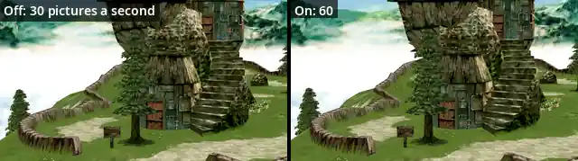

ゲームはほとんどの場面で 30 fps で動きます。Motion smoothing は、フィールドとワールドマップのコマとコマの間の画像を、60、120、144、240 Hz のいずれかで描きます。ゲームの処理と音のタイミングは変わりませんが、ゲームの 1 フレーム分の遅れが加わります。**F1 → ゲームプレイ（Gameplay） → 高速化（Speedup）、Motion smoothing、Motion display rate**。

強化エンジン（**F1 → システム（System） → Engine**）では、代わりにフィールド、ワールドマップ、バトルそのものが 60 fps で動きます。

## パフォーマンスオーバーレイ

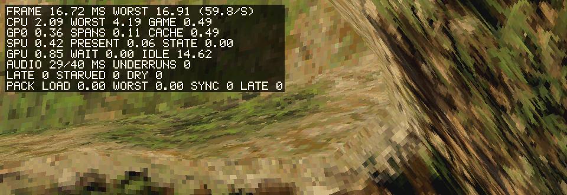

フレーム、CPU、GPU、オーディオの処理時間を表示します。F10 キーで表示し、Shift+F10 でログに書き出します。

## 初期値とキー

| 設定 | 初期値 |
|---|---|
| アスペクト比 | 4:3 テレビ |
| 縦の表示範囲 | オリジナル |
| 拡大方法 | フィット |
| ワイドの余白 | 黒帯 |
| 解像度 | 1x |
| 色 | トゥルーカラー |
| フィルター | ニアレスト |
| ピントの奥行き | オフ |
| ピントの合う範囲 | ノーマル |
| ティルトシフト | オフ |
| ライティング | オフ |
| グロー | オフ |
| 影 | オフ |
| フォグ | オフ |
| カラーグレード | オフ |
| パーティクル | オフ |
| パーティクルの大きさ | 小 |
| ビネット | オフ |
| 高速化 | オフ |
| Motion display rate | 60 Hz |

F11 または Alt+Enter でフルスクリーンになります。**F1 → 画面 → Advanced** には、ジオメトリ（Geometry）、Display lock、VSync待機（VSync wait）があります。ジオメトリの項目は、サブピクセル精度（Subpixel geometry）、パースペクティブ補正（Perspective textures）、Restore thin surfaces、面のすき間を閉じる（Close surface gaps）です。
