# Display

Lahan at 16:9 and six times the PS1 resolution, with Expanded vertical framing.

F1 opens the settings menu (on a gamepad: Guide, or both stick clicks).
Changes apply at once and are saved to `settings.ini`.

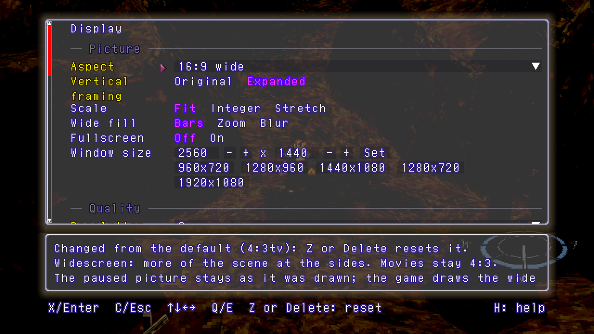

## Widescreen

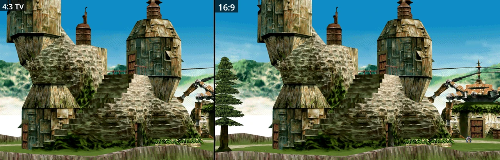

4:3 TV and 16:9: the wide aspects draw more of the scene at the sides.
F1 > Display > Aspect (also F3).

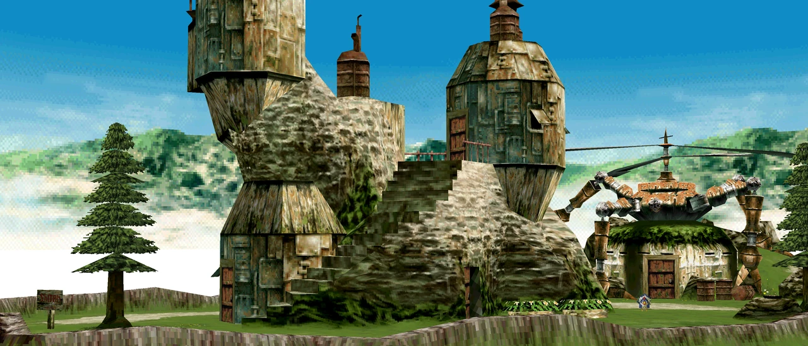

21:9. Aspect also has 4:3 fill, 1:1 square pixels, 16:10, 32:9 and a custom w:h.

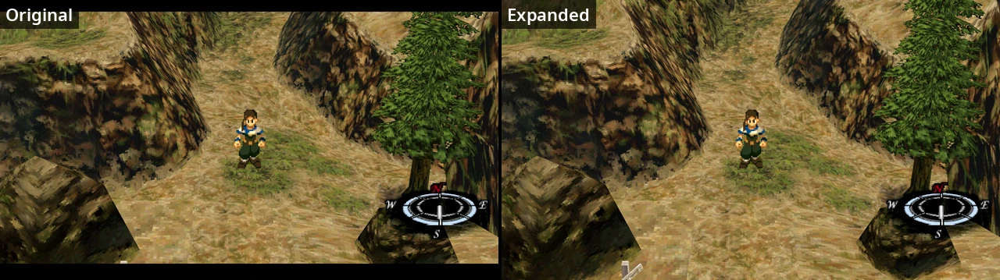

Expanded draws the lines the game leaves black above and below its picture,
in fields, battles and the world map.
F1 > Display > Vertical framing.

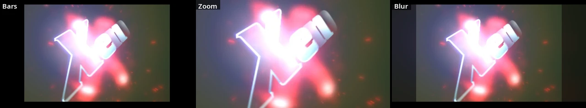

Movies stay 4:3. Wide fill puts bars, a zoomed picture or a blurred one beside
them. F1 > Display > Wide fill (also F6).

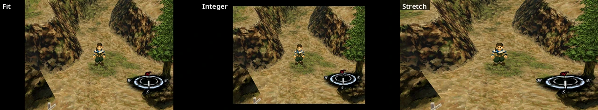

Fit, Integer and Stretch, here a 4:3 picture in a 16:9 window.
F1 > Display > Scale (also F4).

## Resolution and filters

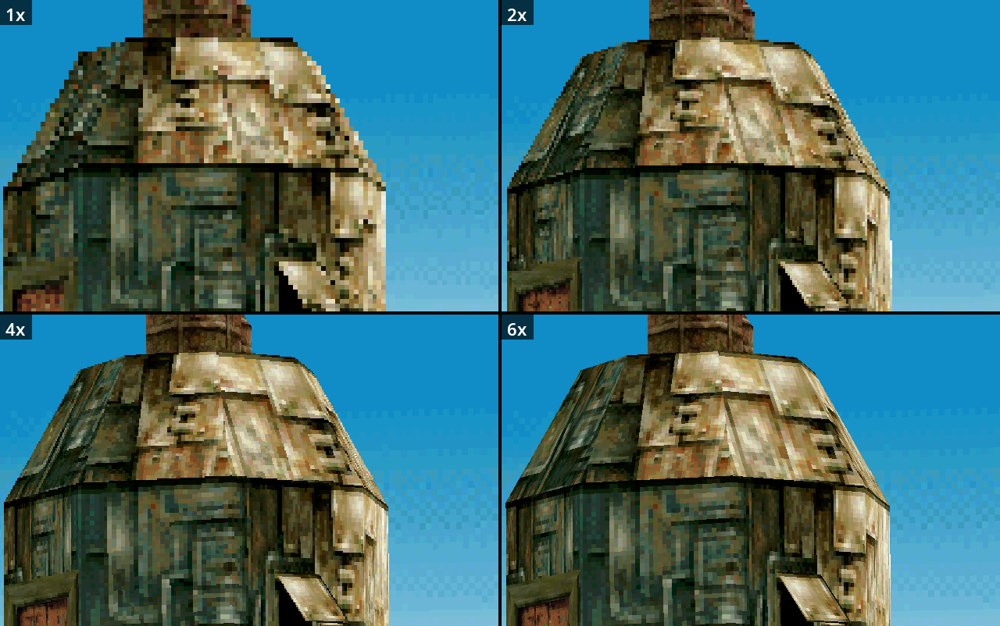

The game drawn at 1x to 12x its resolution, or Auto (from the window's
height). The game itself still works with its 1x picture.
F1 > Display > Resolution (Shift+F4 toggles 1x).

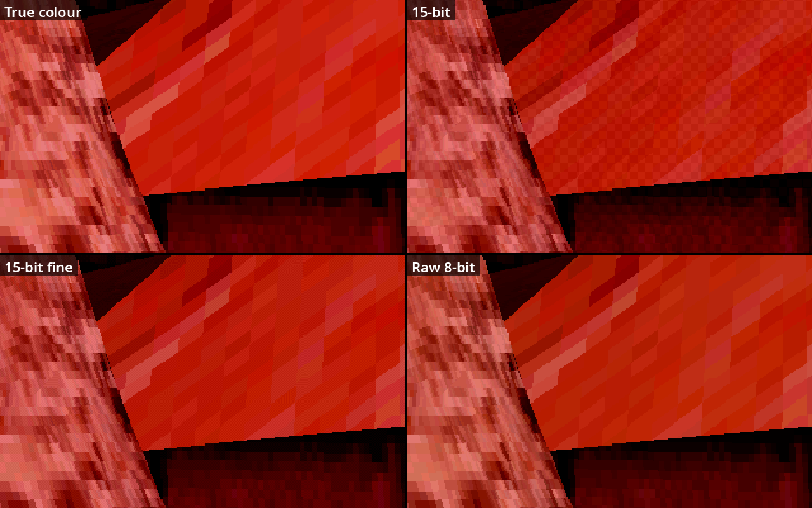

Above 1x: True colour drops the PS1's dither, 15-bit keeps it at PS1 size,
15-bit fine at the higher resolution.
F1 > Display > Colour.

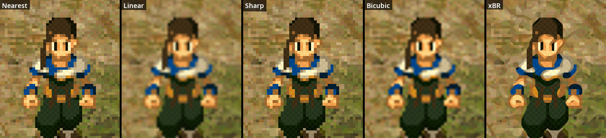

How the picture is scaled to the window: Nearest, Linear, Sharp, Bicubic or
xBR (edges). F1 > Display > Filter (also F5).

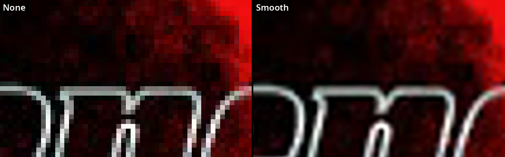

Movies can have a filter and a shader of their own. Smooth (built in)
softens the movies' block edges. F1 > Display > Movies, Movie shader.
Shader takes a RetroArch `.slangp` or `.slang` preset for the whole picture.

## Smoothed motion

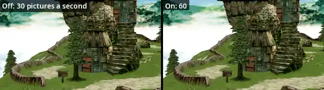

The game runs at 30 fps in most scenes. Motion smoothing draws the
in-between pictures of fields and the world map, at 60, 120, 144 or 240 Hz.
Game logic and sound keep their timing; it adds one game frame of delay.
F1 > Gameplay > Speedup, Motion smoothing, Motion display rate.

The Enhanced engine (F1 > System > Engine) runs fields, the world map and
battles at 60 fps instead.

## Performance overlay

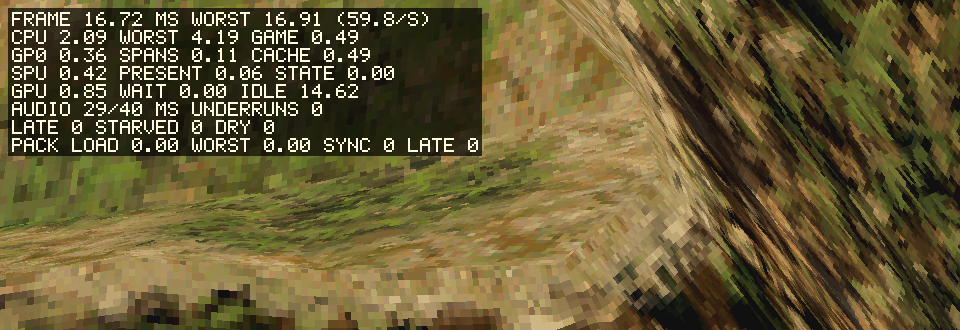

Frame, CPU, GPU and audio timings. F10; Shift+F10 writes them to a log.

## Defaults and keys

| Setting | Default |
|---|---|
| Aspect | 4:3 TV |
| Vertical framing | Original |
| Scale | Fit |
| Wide fill | Bars |
| Resolution | 1x |
| Colour | True colour |
| Filter | Nearest |
| Speedup | Off |
| Motion display rate | 60 Hz |

F11 or Alt+Enter: fullscreen. F1 > Display > Advanced has Geometry (Subpixel
geometry, Perspective textures, Restore thin surfaces, Close surface gaps),
Display lock and VSync wait.
