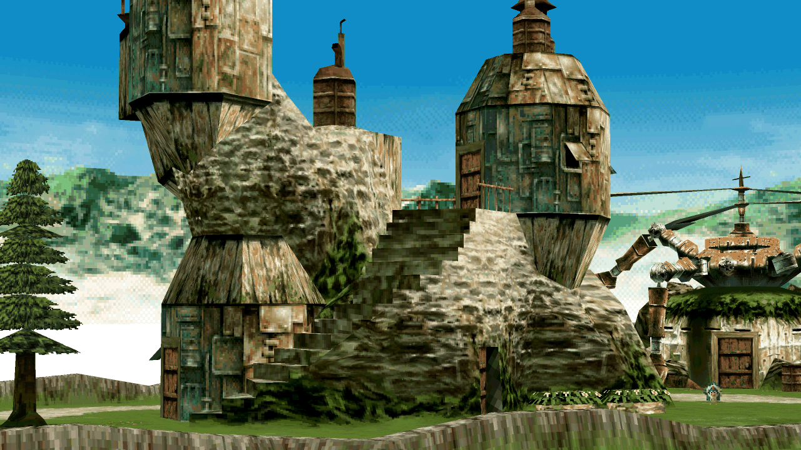

# Display

F1 opens the settings menu (on a gamepad: Guide, or both stick clicks). The
settings below are under F1 > Display unless another section is named. A
change applies at once and is saved to `settings.ini`.

## Picture

| Setting | Choices | Default |
|---|---|---|
| Aspect | 4:3 TV, 4:3 fill, 1:1 square pixels, 16:9 wide, 16:10 wide, 21:9 wide, 32:9 wide, Custom w:h | 4:3 TV |
| Vertical framing | Original, Expanded | Original |
| Scale | Fit, Integer, Stretch | Fit |
| Wide fill | Bars, Zoom, Blur | Bars |
| Fullscreen | Off, On (also F11 or Alt+Enter) | Off |

The wide aspects draw more of the scene at the sides in fields, battles and
the world map. Movies stay 4:3; Wide fill decides what goes beside them.

Expanded vertical framing draws the lines the game leaves black above and
below its 216-line picture, in fields, battles and the world map. Where a
room's art ends, black still shows: no art is invented. The title screen is
zoomed to fill instead.

## Resolution and filters

| Setting | Choices | Default |
|---|---|---|
| Resolution | 1x (PS1 resolution), Auto (from the window), 2x to 12x | 1x |
| Colour | True colour, 15-bit, 15-bit fine, Raw 8-bit | True colour |
| Filter | Nearest, Linear, Sharp, Bicubic, xBR (edges) | Nearest |
| Movies | Same as the filter, or one of the filters | Same as the filter |
| Shader | Off, or a RetroArch `.slangp` / `.slang` preset | Off |

Above 1x the picture is drawn again at the higher resolution for the screen.
The game itself still works with its 1x picture, so higher resolutions do not
change how it plays. Auto picks the largest multiple the window's height
holds. Movies keep their own resolution.

Colour only matters above 1x: True colour drops the PS1's dither, 15-bit keeps
it. Shader presets need a build with Khronos glslang.

F1 > Display > Advanced > Geometry has Subpixel geometry (on by default above
1x), Perspective textures, Restore thin surfaces and Close surface gaps.

## Smoothed motion

The game runs at 30 frames per second in most scenes. Under F1 > Gameplay:

| Setting | Choices | Default |
|---|---|---|
| Speedup | Off, On | Off |
| Motion smoothing | Smooth motion (needs Speedup) | On |
| Motion display rate | Native (59.8 Hz), 60 Hz, 120 Hz, 144 Hz, 240 Hz | 60 Hz |

Motion smoothing draws in-between pictures of fields and the world map:
models, the camera, terrain, particles and clouds. Game logic, animation
events and sound keep their original timing. It adds one game frame of
display delay. Rates above the monitor's refresh rate gain nothing.

The Enhanced engine (F1 > System > Engine) also has 60 Hz fields, 60 Hz world
map and 60 Hz battles, on by default there, which draw those modes at 60
frames per second.

## Keys

| Key | Does |
|---|---|
| F3 | next aspect |
| F4 | next scale |
| Shift+F4 | 1x, or back to the upscaled resolution |
| F5 | next filter |
| F6 | next wide fill |
| F11, Alt+Enter | fullscreen |
| F10 | performance overlay |
