English | [日本語](display-ja.md)

# Display

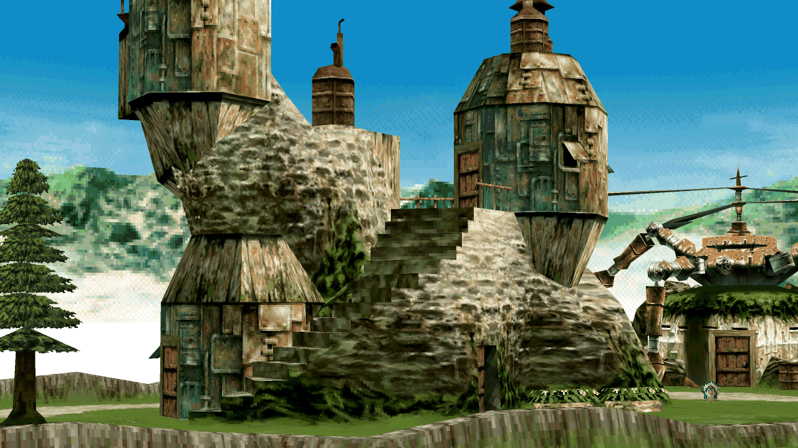

Lahan at 16:9 and six times the PS1 resolution, with Expanded vertical framing.

F1 opens the settings menu (on a gamepad: Guide, or both stick clicks).
Changes apply at once and are saved to `settings.ini`.

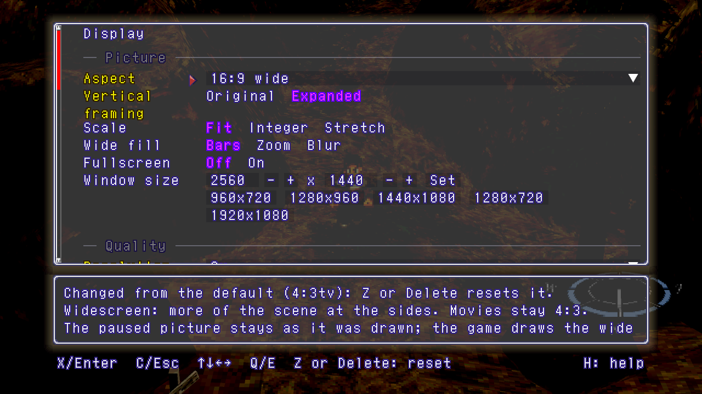

## Widescreen

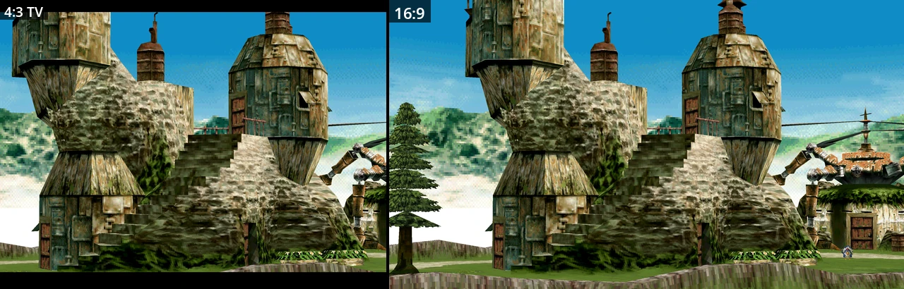

4:3 TV and 16:9: the wide aspects draw more of the scene at the sides.
F1 > Display > Aspect (also F3).

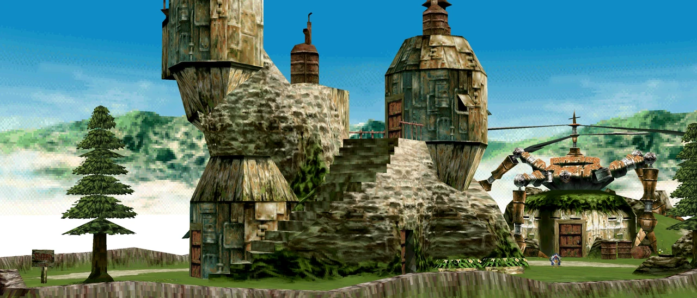

21:9. Aspect also has 4:3 fill, 1:1 square pixels, 16:10, 32:9 and a custom w:h.

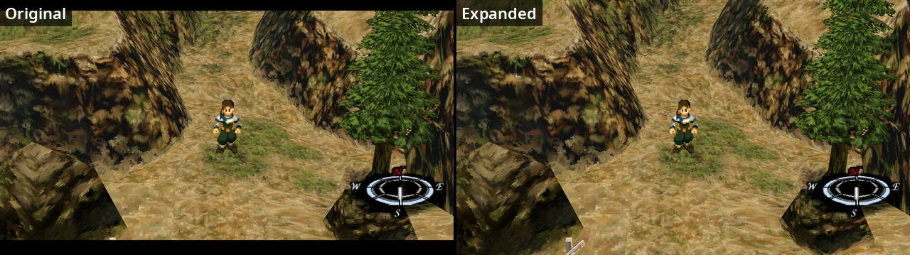

Expanded draws the lines the game leaves black above and below its picture,
in fields, battles and the world map.
F1 > Display > Vertical framing.

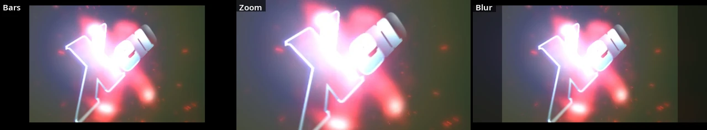

Movies stay 4:3. Wide fill puts bars, a zoomed picture or a blurred one beside
them. F1 > Display > Wide fill (also F6).

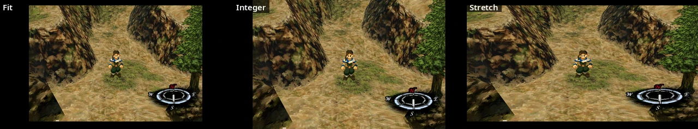

Fit, Integer and Stretch, here a 4:3 picture in a 16:9 window.
F1 > Display > Scale (also F4).

## Resolution and filters

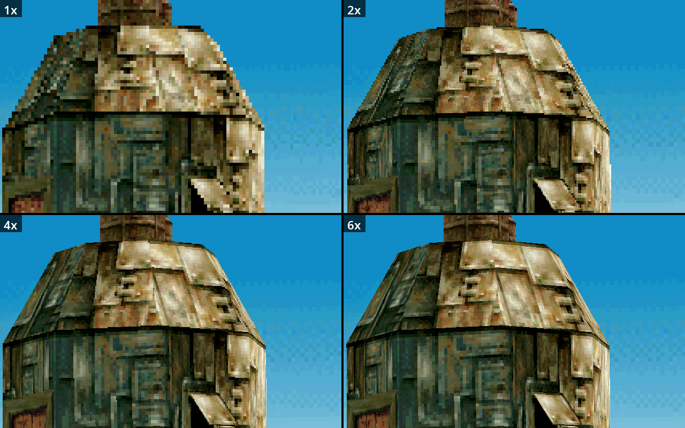

The game drawn at 1x to 12x its resolution, or Auto (from the window's
height). The game itself still works with its 1x picture.
F1 > Display > Resolution (Shift+F4 toggles 1x).

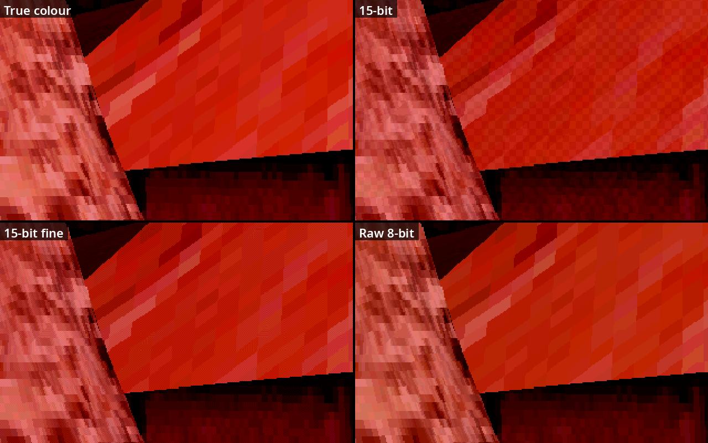

Above 1x: True colour drops the PS1's dither, 15-bit keeps it at PS1 size,
15-bit fine at the higher resolution.
F1 > Display > Colour.

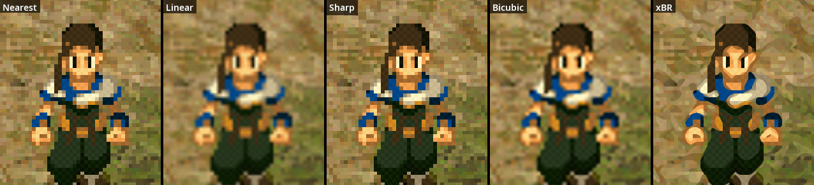

How the picture is scaled to the window: Nearest, Linear, Sharp, Bicubic or
xBR (edges). F1 > Display > Filter (also F5).

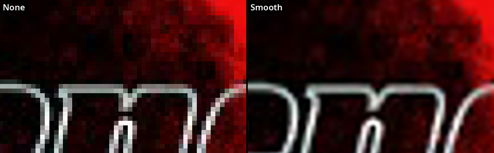

Movies can have a filter and a shader of their own. Smooth (built in)
softens the movies' block edges. F1 > Display > Movies, Movie shader.
Shader takes a RetroArch `.slangp` or `.slang` preset for the whole picture.

## Depth of field

In fields, battles and on the world map, scenery and characters behind
and in front of the party soften, while dialogue, portraits and the HUD
stay sharp. It is the first piece of an HD-2D-style look, and it changes
only how the picture is shown: the game still works with its own. The
Enhanced engine only (F1 > System > Engine).
F1 > Display > Depth of field (Off, Subtle, Medium, Strong) and Focus range
(Narrow, Normal, Wide: how deep the sharp range around the party is).

In fields, while someone speaks, the focus moves to them and the sharp
range narrows a little, so the room around them softens; it eases in and
back out over half a second. F1 > Display > Dialogue focus (On by default)
turns it off.

## Tilt-shift

In fields and on the world map, the picture blurs toward its edges,
faintly at first and most at the edge, so the scene looks like a
miniature. It adds to the depth of field: where both blur, the stronger
shows. Dialogue,
portraits and the HUD stay sharp. The Enhanced engine only (F1 > System >
Engine). F1 > Display > Tilt-shift (Off, Subtle, Medium, Strong).

## Lighting and glow

In fields, battles and on the world map, Lighting lights the scenery from
above: floors, roofs and table
tops get brighter and undersides darker, corners and the ground under
overhangs get shade, and bright spots such as lamps and fires light what is
near them. Glow makes bright areas glow softly. Both are made from the
picture the game draws and its depth. The rooms carry almost no lights of
their own, so the light comes from above in every room. Dialogue, portraits
and the HUD are not touched, and the game still works with its own picture.
The Enhanced engine only (F1 > System > Engine).
F1 > Display > Lighting and Glow (each Off, Subtle, Medium, Strong).

With Lighting on, the characters take it too: each is lit as if it were
round, brighter on the side toward the sun with a thin warm edge there and
darker on the far side, gets shade at its feet in a corner, and what is near
white on it glows. F1 > Display > Light on characters (On by default) turns
it off.

With Lighting or Glow on, fires, torches and lamps flicker indoors, at night
and in battles (not in daylight, where a sunlit roof could pass for a
flame): the light they throw on what is around them and their glow rise and
fall, each fire in its own rhythm, while windows, the sky and white or blue
lights stay steady. They keep their painted brightness under the lighting's
shade and fog, and so does a flame drawn see-through over a wall. Scenes the
game redraws over itself, such as Lahan burning with its heat shimmer, take
every effect too. F1 > Display > Firelight flicker (On by default) turns it
off.

## Shadows

In fields, battles and on the world map, the scenery casts shadows from a
sun (and the characters too), which is
set from the camera a room starts with and then stays put in the room, so
the shadows don't swing when the camera turns. Walls, furniture and props
cast through the picture's depth; each character's sprite is laid on the
ground away from the sun, beside the game's own shadow under it, darkest at
the feet and fading toward the head's end. Painted
lights such as windows and lamps stay as bright as they are painted. The
Enhanced engine only (F1 > System > Engine).
F1 > Display > Shadows (Off, Subtle, Medium, Strong).

## Fog and colour grade

In fields, battles and on the world map, Fog lays a haze that thickens past
the characters, in the colour
of the room's farthest scenery, so distant hills, seas and skies recede.
Small rooms barely change. Colour grade makes shadows a little cool and
highlights a little warm, with a touch more colour and contrast. Dialogue,
portraits and the HUD are not touched. The Enhanced engine only (F1 > System
> Engine). F1 > Display > Fog and Colour grade (each Off, Subtle, Medium,
Strong).

Colour grade also leans gently into each place's own colour, read from the
scenery itself: a sandy place a little warmer, a green one a little greener,
a dark one a little bluer in its shadows, characters included. F1 > Display >
Adapt to the area (On by default) turns that off.

## Particles

In fields, battles and on the world map, fine dust drifts where the place is lit
(windows, lamps, sunlit ground) and warm embers where it is dark, chosen by
how bright the place is. Each stays at its place in the room as the camera
moves, behind the scenery and the characters in front of it, and as blurred
as the depth of field makes things at its distance. Dialogue, portraits and
the HUD are not touched. The Enhanced engine only (F1 > System > Engine).
F1 > Display > Particles (Off, Subtle, Medium, Strong) and Particle size
(Small, Medium, Large).

With Particles on, characters also kick up dust where they walk on sand, dirt
or a dusty floor, more when they run: soft clouds a step paler than the
ground, lingering a moment, none on grass, water or snow. F1 > Display >
Footstep dust (On by default) turns it off.

## Vignette

In fields, battles and on the world map, the picture's edges a little
darker, drawing the eye to the middle: up to 12, 22 or 35% darker at the
corners. Dialogue, portraits and the HUD are not touched. The Enhanced engine
only (F1 > System > Engine). F1 > Display > Vignette (Off, Subtle, Medium,
Strong).

## Light shafts

In fields and on the world map, light spills in shafts from what is much
brighter than the place around it (windows, openings, the sky behind), in
soft bands along the sun's way, and gentle sunbeams slant down from the
top of the picture over the scenery. Dialogue, portraits and the HUD are
not touched. The Enhanced engine only (F1 > System > Engine). F1 > Display
> Light shafts (Off, Subtle, Medium, Strong).

## Sun glare

On the world map and in fields outdoors by day, a soft warm glow spills in
from the sun's side of the picture (the side the shadows fall away from),
with a few faint lens rings across it, as a camera facing the light would
see. It shows only as far as sky or far scenery shows on that side: a wall or
a cliff there blocks it. Dialogue, portraits and the HUD are not touched. The
Enhanced engine only (F1 > System > Engine). F1 > Display > Sun glare (Off,
Subtle, Medium, Strong).

## Cloud shadows

On the world map and in fields outdoors by day, the soft shadows of large
clouds drift slowly over the ground, from the same sun as the shadows. They
keep their places on the ground as the camera moves and slant across walls;
where a cloud and a cast shadow meet, the darker of the two shows. Rooms,
caves and scenes at night get none. Dialogue, portraits and the HUD are not
touched. The Enhanced engine only (F1 > System > Engine). F1 > Display >
Cloud shadows (Off, Subtle, Medium, Strong).

## Smoothed motion

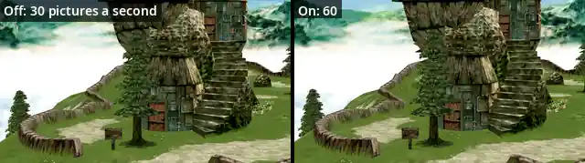

The game runs at 30 fps in most scenes. Motion smoothing draws the
in-between pictures of fields and the world map, at 60, 120, 144 or 240 Hz.
Game logic and sound keep their timing; it adds one game frame of delay.
F1 > Gameplay > Speedup, Motion smoothing, Motion display rate.

The Enhanced engine (F1 > System > Engine) runs fields, the world map and
battles at 60 fps instead.

## Performance overlay

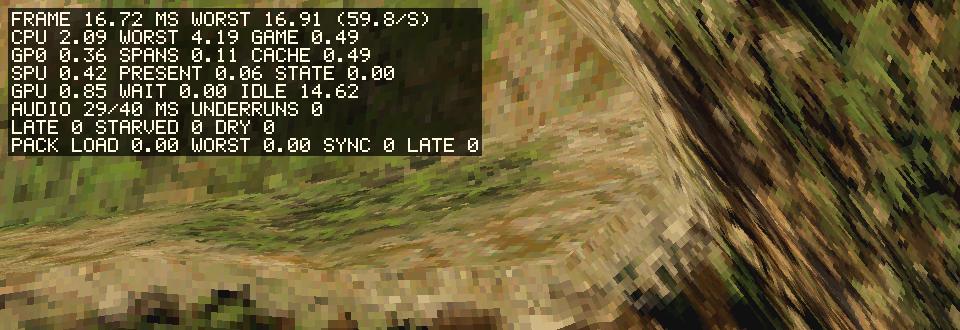

Frame, CPU, GPU and audio timings. F10; Shift+F10 writes them to a log.

## Defaults and keys

| Setting | Default |
|---|---|
| Aspect | 4:3 TV |
| Vertical framing | Original |
| Scale | Fit |
| Wide fill | Bars |
| Resolution | 1x |
| Colour | True colour |
| Filter | Nearest |
| Depth of field | Off |
| Focus range | Normal |
| Dialogue focus | On |
| Tilt-shift | Off |
| Lighting | Off |
| Firelight flicker | On |
| Light on characters | On |
| Glow | Off |
| Shadows | Off |
| Fog | Off |
| Colour grade | Off |
| Adapt to the area | On |
| Particles | Off |
| Particle size | Small |
| Footstep dust | On |
| Vignette | Off |
| Light shafts | Off |
| Sun glare | Off |
| Cloud shadows | Off |
| Speedup | Off |
| Motion display rate | 60 Hz |

F11 or Alt+Enter: fullscreen. F1 > Display > Advanced has Geometry (Subpixel
geometry, Perspective textures, Restore thin surfaces, Close surface gaps),
Display lock and VSync wait.
