[English](gameplay.md) | 日本語

# ゲームプレイ

ボス戦のカメラ修正（Boss camera fix）は初期設定でオンです。そのほかのゲームプレイの設定は、初期設定では原作どおりの値です。

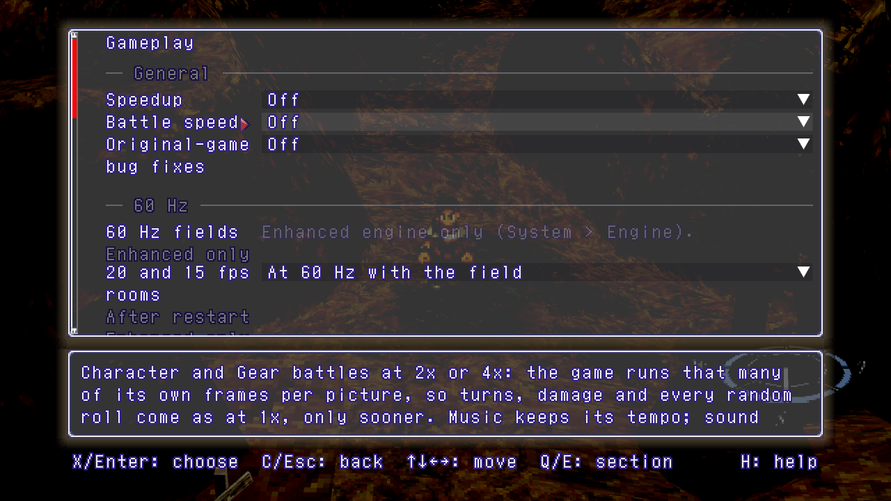

## 戦闘速度

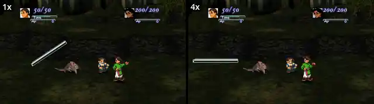

同じバトルを 1x と 4x で比べたものです。ターンもダメージも乱数の結果も同じで、早く進むだけです。音楽のテンポは変わりません。メニュー、ターゲットの選択、会話は 1x のままです。F1 > ゲームプレイ（Gameplay） > 戦闘速度（Battle speed）：オフ、1x、2x、4x。

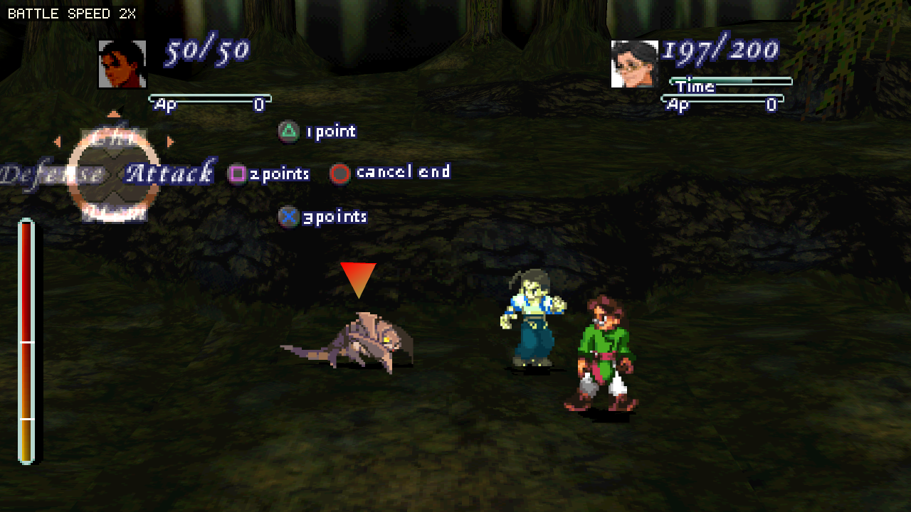

バトル中は Tab（または Select + R2）で 1x、2x、4x と切り替わり、画面の隅に表示が出ます。

## バトル

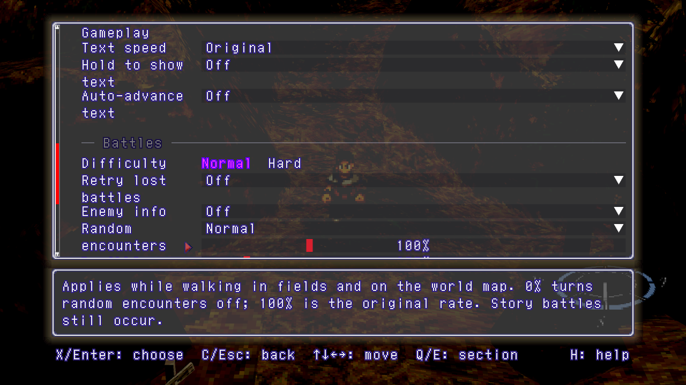

F1 > ゲームプレイ > Battles。Advanced には、敵の能力値ごとの倍率（25% から 400%）と、経験値とゴールドの倍率（ランダムバトルとイベントバトルで別々、0% から 1000%）があります。

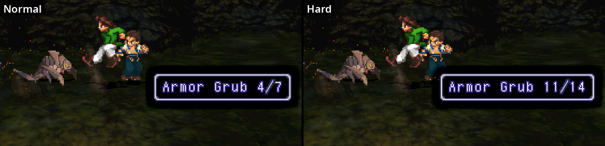

敵の情報（Enemy info）：Select だけを押すと、各敵の名前、HP、状態を表示します。画像は同じ敵をノーマルとハードで比べたものです。F1 > ゲームプレイ > 敵の情報：オフ、常に、倒した敵の HP だけ。難易度（Difficulty）：ノーマル、ハード。

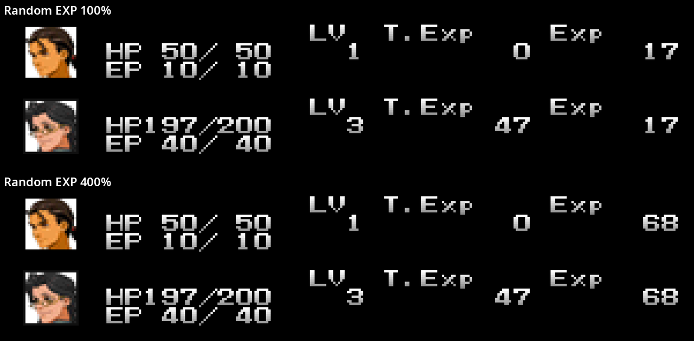

同じバトルを、ランダム経験値 100% と 400% で比べたものです。F1 > ゲームプレイ > Advanced > ランダム経験値（Random EXP）。

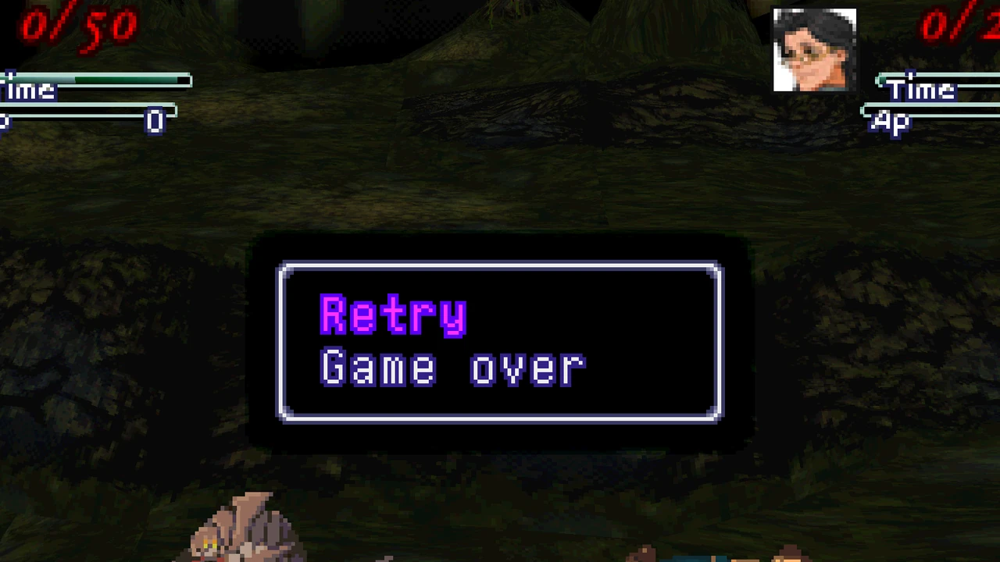

負けたらやり直し（Retry lost battles）：そのときのアイテム、HP、ギアのまま、バトルの最初からもう一度戦えます。F1 > ゲームプレイ > 負けたらやり直し。

エンカウント（Random encounters）：オフ、少なめ、ノーマル、多め、または 0% から 400%。ストーリー上のバトルはこれまでどおり起こります。F1 > ゲームプレイ > エンカウント。

## ステートセーブと巻きもどし

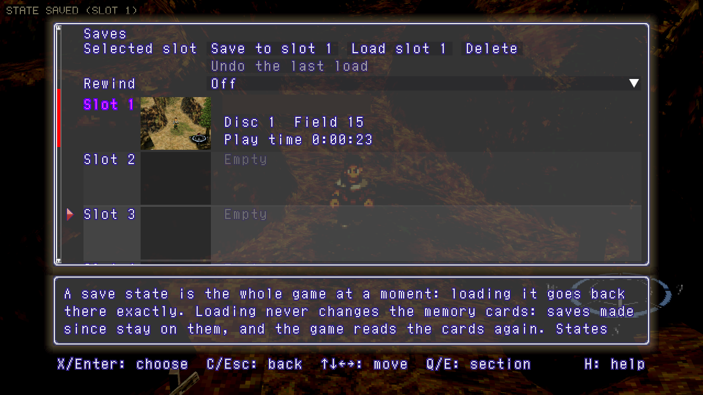

スロットは 10 個で、それぞれにその時点の画面の絵が付きます。F7 でセーブ、F8 でロード、F9 と Shift+F9 でスロットを選び、Shift+F8 で直前のロードを取り消します。ステートセーブでメモリーカードが書き換わることはありません。F1 > セーブ（Saves）。

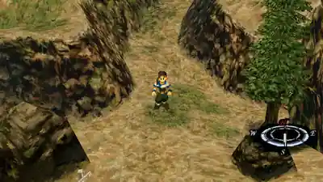

巻きもどし（Rewind）は直前の 30 秒を記録します。R（または Select + L2）を押し続けると巻きもどり、離すとそこから続けて遊べます。F1 > セーブ > 巻きもどし（初期設定はオフ）。

## ボス連戦

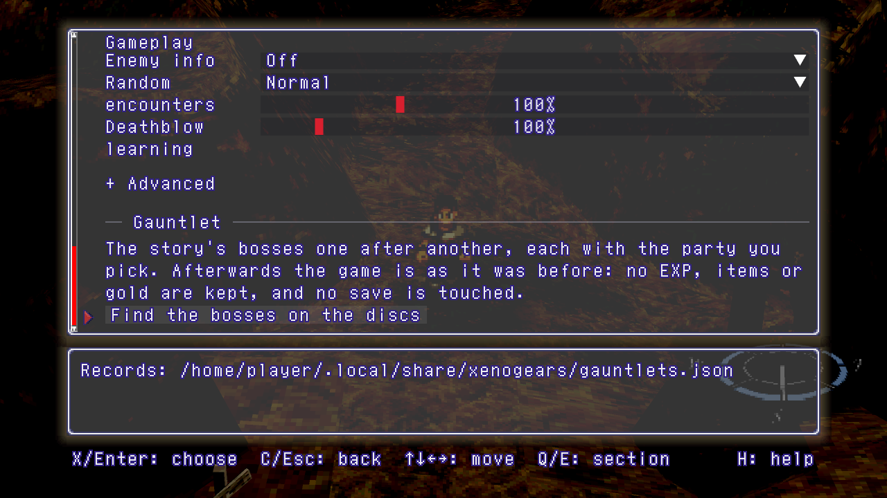

ストーリーのボスと次々に戦います。パーティは戦いごとに選べます。終わるとゲームは元の状態に戻ります。F1 > ゲームプレイ > ボス連戦（Gauntlet）。

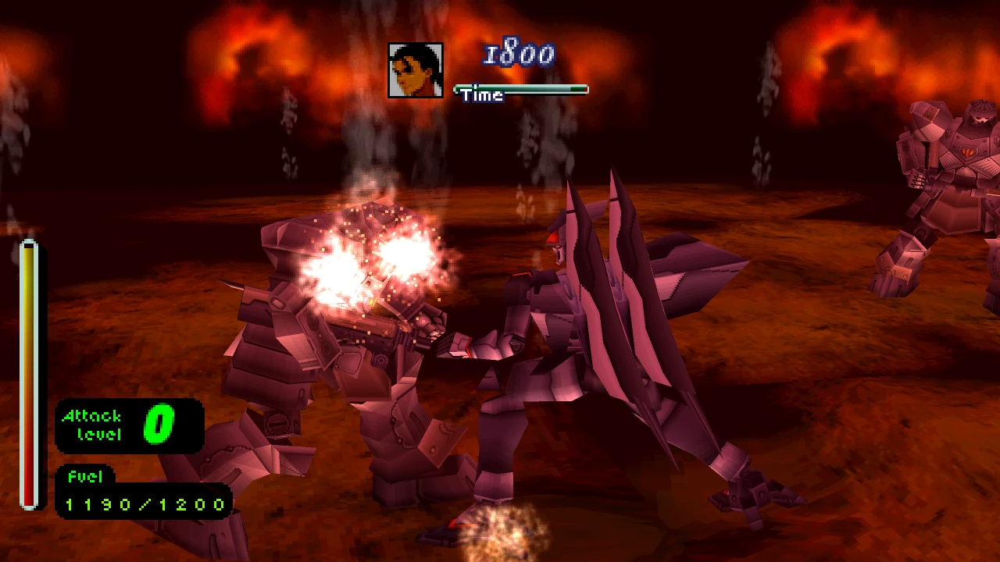

ボスは、すべてのボスをストーリー順に、キャラクターのボス、ギアのボス、または自分のリストから選びます。戦いの合間の回復は、全快、25%、50%、復活だけ、なしのいずれかです。負けた戦いはリトライでき、挑戦はすべて記録されます。画像はギアのボスの最初の戦いで、ヴェルトールとムシャ Mk100 の戦闘です。

## 操作とサウンド

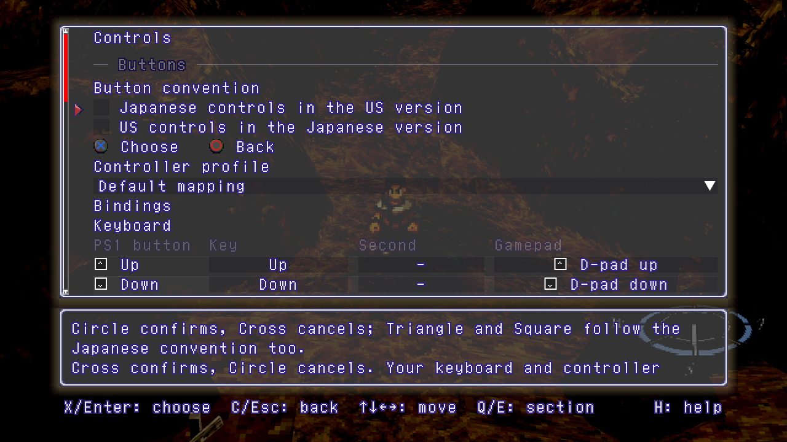

北米版での日本版の操作（○ボタンで決定）や日本版での北米版の操作、キーとゲームパッドの割り当て、マウスの設定です。F1 > 操作（Controls）。

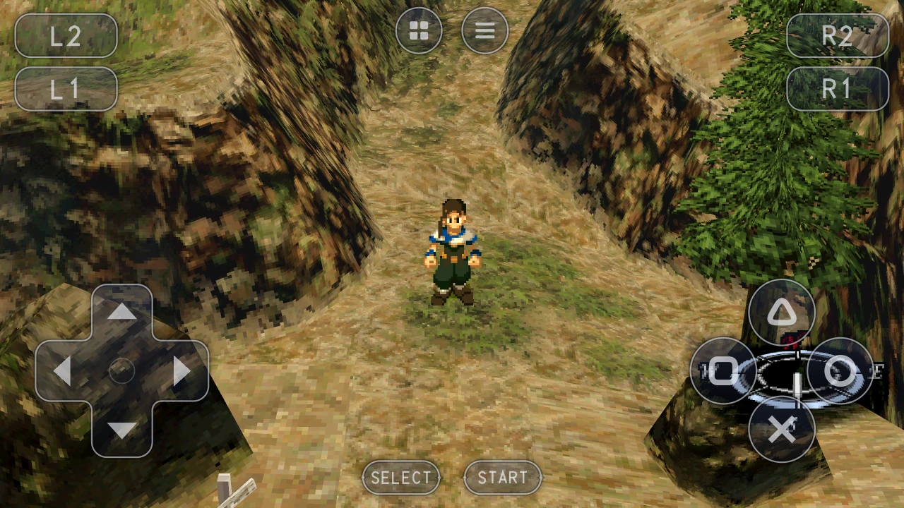

タッチパッドは、タッチ画面向けに PlayStation のパッドをゲームの上に描きます。F1 > 操作 > タッチパッド（Touch pad）で、オフ、オン、自動（Automatic。最初に触れてから、コントローラーかキーボードを使うまで表示。Android の初期設定）から選びます。配置（Layout）は、ボタン（Buttons）か、ボタンとスティック（Buttons and sticks）です。パソコンでは、タッチ画面があるとき、または `settings.ini` で `touch_pad` を設定したときに、これらの行が表示されます。

強化エンジン（**F1 → システム → Engine**）では、**F1 → 操作 → カメラと振動（Camera and vibration）** で **ファーストパーソン視点（First-person look）** をオンにします。フィールドで、またはワールドマップを徒歩、ギア、ユグドラシルで移動しているときに、**V** を押すか、**L2** を押したまま **L3** を押し込みます。視点は右スティック、**J/L** と **I/K**、またはマウスの右ドラッグで動かします。

**ファーストパーソン視点のまま移動する（Move in first-person view）** をオンにすると、見ている方向を基準に前後や横へ歩けます。飛行中のユグドラシルはいつもどおりの舵取りとスロットルのままで、視点は船の旋回についていきます。このオプションがオフのときは、立ち止まって見回し、移動すると元の視点に戻ります。ショートカットをもう一度押すと、前の視点に戻ります。どちらのオプションも最初はオフです。会話、演出のカット、固定視点の部屋では、ゲームのカメラを使います。

同じグループの **フィールドの自由カメラ（Free camera in fields）**（強化エンジン）では、右スティックでパーティーのまわりのカメラを回したり傾けたりでき、L2 を押したままスティックを上下に動かすとズームします（キーボードでは J/L で回転、I/K で傾き、U/O でズーム）。R3 か Home でゲームの視点に戻ります。カメラが固定の場面や部屋では、ゲームのカメラのままです。

同じグループの **振動（Vibration）** は、オフ、**ゲーム本来（The game's）**、**強化（Enhanced）** から選びます。ゲーム本来は DualShock と同じで、ゼノギアス自体が振動するのは、バトリングの闘技場でその振動オプションをオンにしたときだけです。強化では、受けた攻撃と与えた攻撃、戦闘不能、ギアの衝撃、必殺技、バトルとフィールドのカメラの揺れでも振動します。**強さ** で強さを決め、**テスト（Test）** で短く振動させて確かめられます。パッド 1 にモーター付きのコントローラーが必要です。

**F1 > サウンド（Audio） > 音（Sound） > バイノーラル（ヘッドホン）（Binaural (headphones)）** は、楽器と、左右に振られた効果音を、前方に広がる音場に配置します。プレイ中にオンとオフを切り替えて聞き比べてください。ムービーの音声はステレオのミックスのままです。

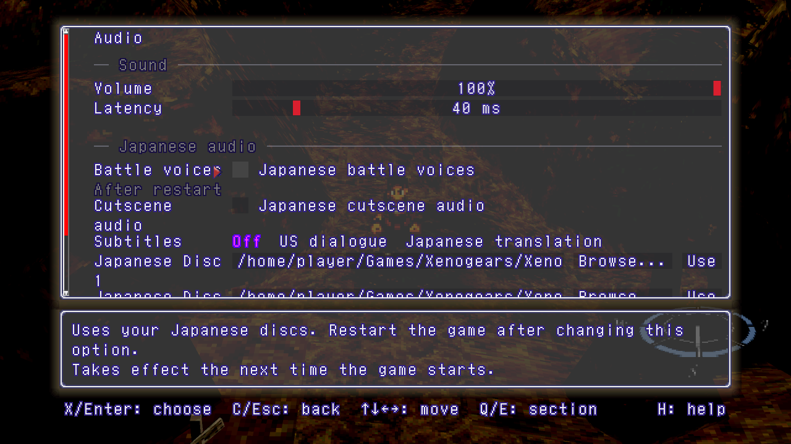

北米版で、お手持ちの日本版ディスクのバトルボイスとカットシーンの音声を使えます。F1 > サウンド > Japanese audio。

## そのほかの設定

| 設定 | 内容 |
|---|---|
| 高速化（Speedup） | メモリーカードとロードの待ち時間を短くします。なめらかな動きもオンになります |
| フィールド速度（Field speed） | フィールドとワールドマップを、イベントや会話も含めて 2 倍か 4 倍で進めます。メニュー、ムービー、バトルはそれぞれの速さのままです |
| 原作の不具合修正（Original-game bug fixes） | 原作にある一連の不具合を修正します |
| ボス戦のカメラ修正 | 終盤のあるボスの攻撃で、カメラが止まるのを防ぎます |
| 文字の速さ（Text speed） | オリジナル、2 倍、3 倍、4 倍、8 倍、瞬時 |
| 押して全部表示（Hold to show text） | 決定ボタンを押し続けると、ページの残りを表示します |
| 文字の自動送り（Auto-advance text） | 表示し終えたページは、1〜8 秒後に自動で次へ進みます |
| 必殺技の習得（Deathblow learning） | 攻撃ごとの練習量、0% から 1000% |
