English | [日本語](gameplay-ja.md)

# Gameplay

The boss camera fix is on by default. Other gameplay options default to the original values.

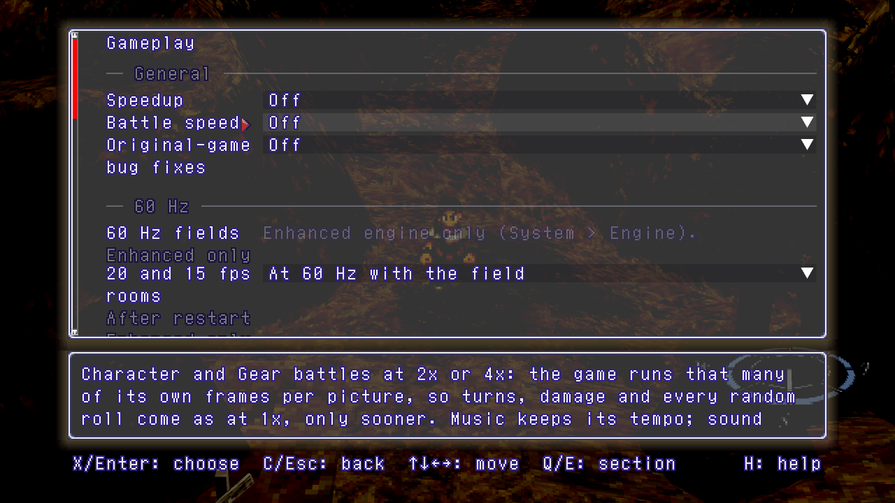

## Battle speed

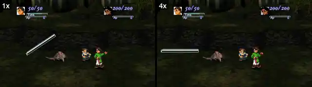

The same battle at 1x and 4x. Turns, damage and random rolls are the same,
only sooner; music keeps its tempo. Menus, target selection and dialogue
stay at 1x. F1 > Gameplay > Battle speed: Off, 1x, 2x, 4x.

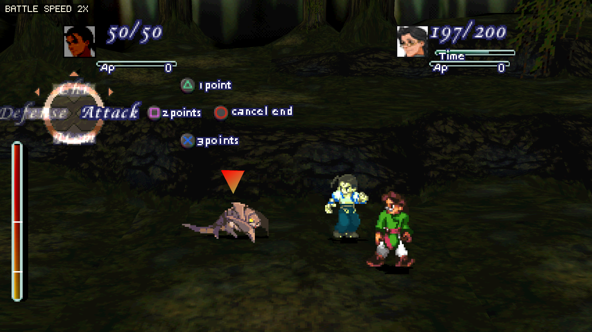

In a battle, Tab (or Select + R2) steps 1x, 2x, 4x, with a note in the corner.

## Battles

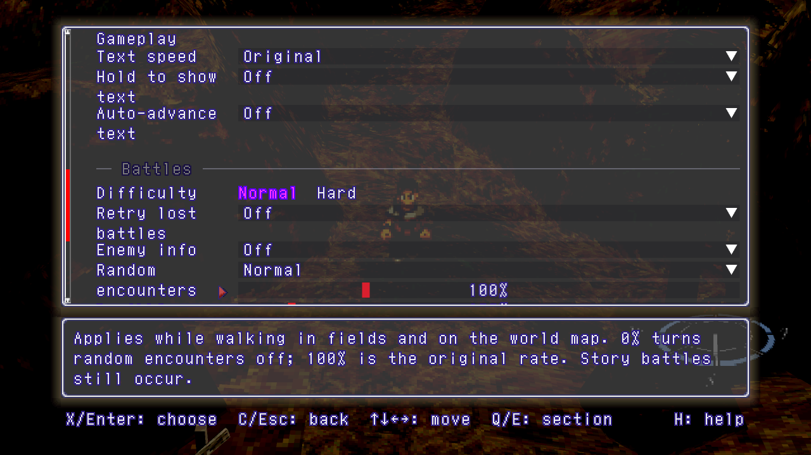

F1 > Gameplay > Battles. Advanced has a multiplier for each enemy stat (25% to
400%) and for EXP and gold, random and scripted battles apart (0% to 1000%).

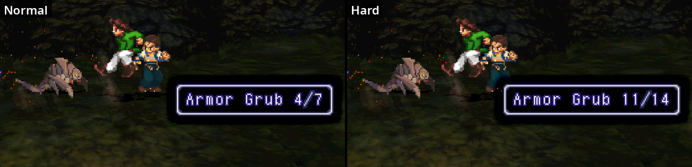

Enemy info: a lone Select press shows each enemy's name, HP and statuses.
Here the same enemy at Normal and at Hard. F1 > Gameplay > Enemy info
(Off, Always, HP once beaten) and Difficulty (Normal, Hard).

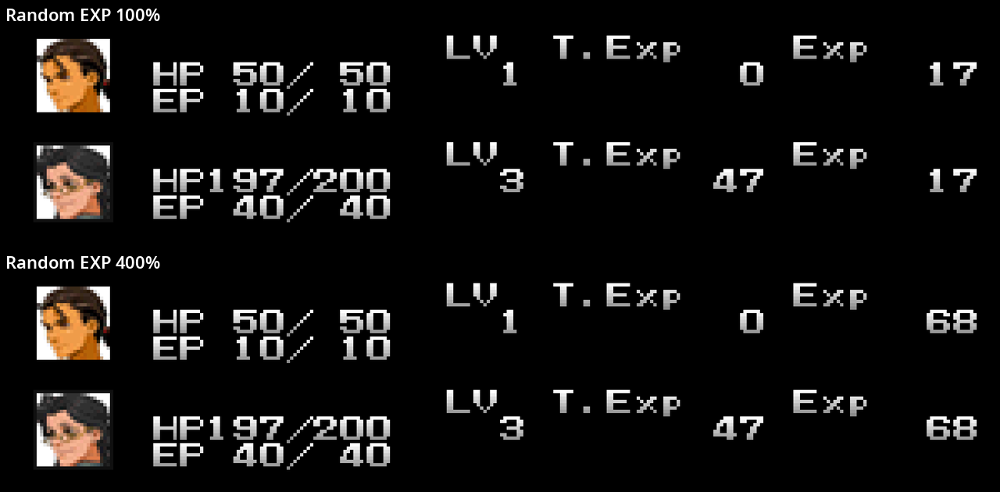

The same battle with Random EXP at 100% and 400%.
F1 > Gameplay > Advanced > Random EXP.

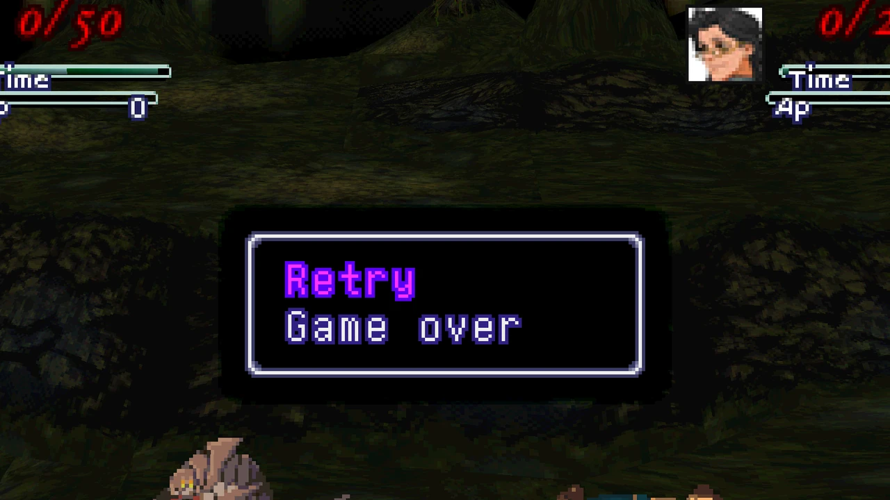

Retry lost battles: fight again from the battle's start, with the items, HP
and Gears you had. F1 > Gameplay > Retry lost battles.

Random encounters: Off, Reduced, Normal, Increased, or 0% to 400%. Story
battles still happen. F1 > Gameplay > Random encounters.

## Memory cards

The port uses raw 128 KB PlayStation memory card images (`.mcd`, `.mcr`, `.mc`,
`.srm`): the same format as DuckStation, Mednafen/Beetle PSX, PCSX-Redux and
original hardware dumps. Saves are compatible both ways — a card or save made in
the port loads back in an emulator or on a PlayStation (rename `.mcd` to `.mcr`
if another tool expects it). US builds use US saves (`BASLUS-00664...`) and
Japanese builds use Japanese saves (`BISLPS-01160...`).

Default cards are `card1.mcd` and `card2.mcd` in `~/.local/share/xenogears/`
(Windows: `%APPDATA%\xenogears\`). F1 > Saves > Memory cards swaps the image in
either slot while the game is paused, lists saves on the card, imports and
exports single saves (`.mcs`, plus import of 54-byte header saves such as
Xploder/Action Replay), and restores from the last ten automatic backups kept
beside each image (`<image>.backups/`). Container formats with extra headers
(`.gme`, `.vmp`, `.psv`) need to be converted to a raw 128 KB image or `.mcs`
first.

The command line manages cards without starting the game:

```sh
xenogears --card list   1
xenogears --card export 1 BASLUS-006640 save.mcs
xenogears --card import 1 save.mcs [--replace]
xenogears --card delete 1 BASLUS-006640
xenogears --card format 1
```

Pass `1`, `2`, or a path to a 128 KB card image. `card1` and `card2` in
`settings.ini`, and the `XG_CARD1`, `XG_CARD2` and `XG_CARD_DIR` environment
variables, set the card paths.

## Save states and rewind

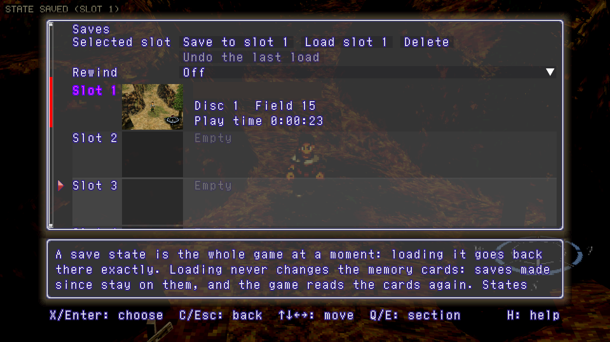

Ten slots with a picture of each. F7 saves, F8 loads, F9 and Shift+F9 choose
the slot, Shift+F8 undoes the last load. Memory cards are never changed by a
state. F1 > Saves.

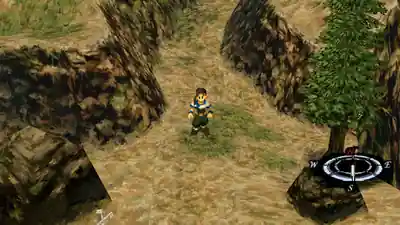

Rewind keeps the last 30 seconds: hold R, or Select + L2, to go back; let go
to play on. F1 > Saves > Rewind (Off by default).

## Gauntlet

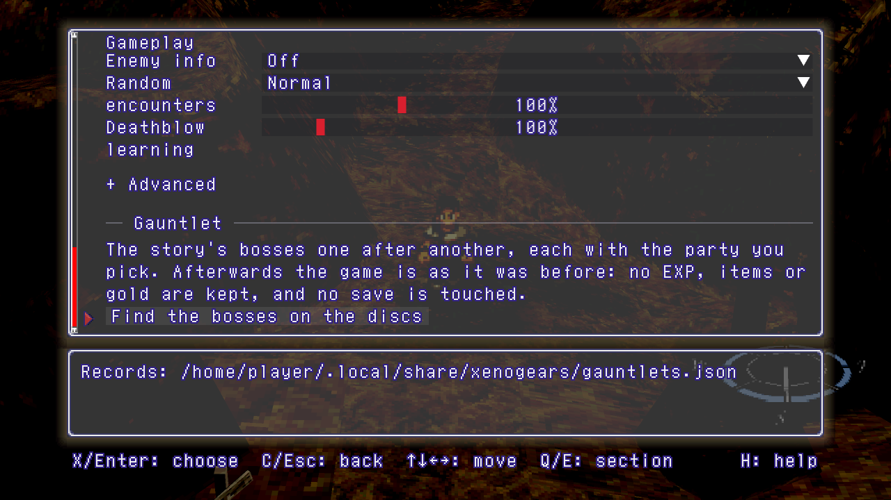

The story's bosses one after another, with the party you pick for each fight.
Afterwards the game is put back as it was. F1 > Gameplay > Gauntlet.

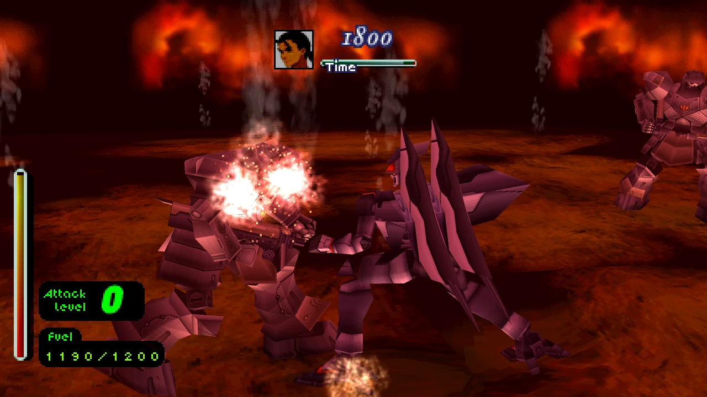

Bosses: every one in story order, the Character bosses, the Gear bosses, or a
list of your own. Recovery between fights: full, 25%, 50%, revive only or none.
A lost fight can be retried, and every run is recorded. Here the Gear bosses'
first fight, Weltall against the Musha Mk100s.

## Controls and audio

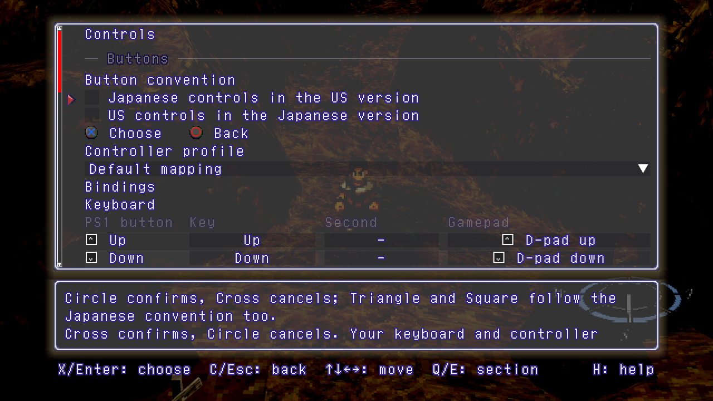

Japanese controls in the US version (Circle confirms) or US controls in the
Japanese version, key and gamepad bindings, mouse.
F1 > Controls.

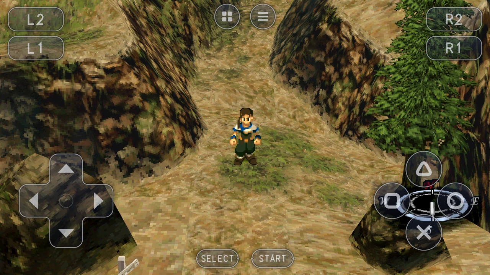

The touch pad draws a PlayStation pad over the game, for touch screens.
F1 > Controls > Touch pad: Off, On, or Automatic (from your first touch until
you use a controller or a keyboard; Android's default). Layout: Buttons, or
Buttons and sticks. On a computer the rows show with a touchscreen, or once
`touch_pad` is set in `settings.ini`.

With the Enhanced engine (F1 → System → Engine), turn on **First-person look** under
**F1 → Controls → Camera and vibration**. In a field or while travelling the
world map on foot, in a Gear or aboard the Yggdrasil, press **V**, or hold **L2** and click **L3**.
Look with the right stick, **J/L** and **I/K**, or a right mouse drag.

Turn on **Move in first-person view** to walk forward, back or sideways relative
to where you look. In flight, the Yggdrasil keeps its usual steering and throttle,
and the view follows the ship as it turns. With that option off, stand still to look and move to leave.
Press the shortcut again to return to the previous view. Both options start off.
Dialogue, scripted shots and fixed-view rooms use the game camera.

**Free camera in fields**, in the same group (Enhanced engine): turn and tilt the
camera around the party with the right stick, and hold L2 and move the stick up or
down to zoom (keys: J/L turn, I/K tilt, U/O zoom). R3 or Home returns to the
game's view. Scenes and rooms with a fixed camera keep the game's.

**Vibration**, in the same group: Off; The game's, as on a DualShock (Xenogears
itself vibrates only in the Battling arena, with the arena's Vibration option on);
or Enhanced, which adds hits taken and dealt, knock-outs, Gear impacts, deathblows
and the camera shakes of battles and fields. Strength sets how strong, and Test
plays a short pulse. It needs a controller with motors on pad 1.

**F1 > Audio > Sound > Binaural (headphones)** places instruments and panned sound effects across a frontal soundstage. Switch it on or off while playing to compare. Movie audio keeps its stereo mix.

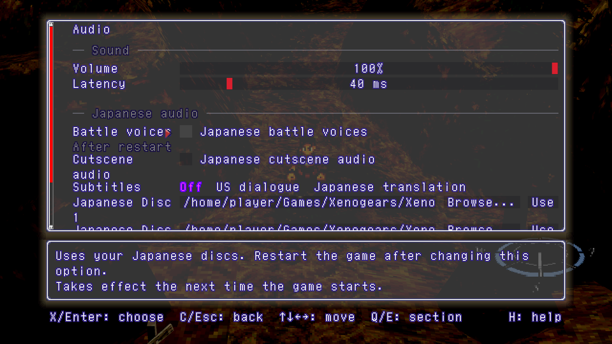

Battle voices and cutscene audio from your Japanese discs, in the US version.
F1 > Audio > Japanese audio.

## Other settings

| Setting | What it does |
|---|---|
| Speedup | Shorter memory card and loading waits; turns on smoothed motion |
| Field speed | Fields and the world map at 2x or 4x, their scenes and dialogue included; menus, movies and battles keep their own speed. There Tab (or Select + R2) steps 1x, 2x, 4x; while it is on, Select does its own job there (the area map, the minimap) as you let it go |
| Speedup transitions | Opening the main menu from the field or the world map and closing it, and going from room to room on the field, at 4x: the fades, the loads and the menu's own animation; the menu itself, the field and every other screen keep their speed |
| Dialogue backlog | Keeps the text the game shows (field, world map, a battle's story lines, movie captions); H or Select + Square opens it over the paused game in the game's own window and letters, Up and Down scroll, L1 and R1 page |
| PS1 frame rate | Heavy scenes drawn as slowly as on the PlayStation: each picture takes the time the console's CPU needed for it (a model of it); the game keeps its speed. Original engine |
| Original-game bug fixes | Fixes a list of bugs in the original game: [Bug fixes](bugfixes.md) |
| Boss camera fix | Prevents a camera stall during one late-game boss attack |
| Text speed | Original, 2x, 3x, 4x, 8x, Instant |
| Hold to show text | Holding confirm shows the rest of a page |
| Auto-advance text | A finished page goes on by itself after 1 to 8 s |
| Deathblow learning | Practice per attack, 0% to 1000% |
| Uninterrupted combos | A Combo's deathblows back to back: no charge-up pose before each after the first, and the jump back into the ready stance only where a deathblow needs it (to start on the enemy's far side, or well away from where the last one ended) |
| Disable battle flashes | Removes the white flash when a battle starts and the screen shatters, and the full-screen flashes when performing attacks; fades to and from black stay as they are |
