# Gameplay

Everything here is off or at the original values by default.

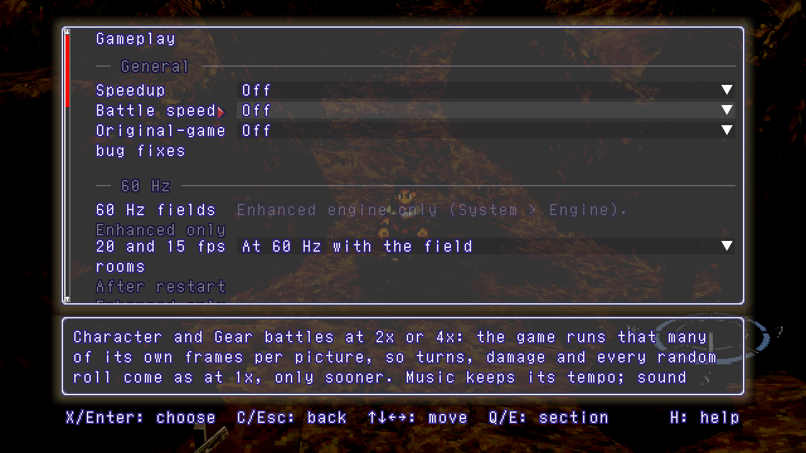

## Battle speed

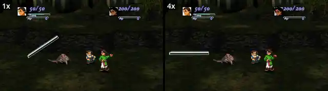

The same battle at 1x and 4x. Turns, damage and random rolls are the same,
only sooner; music keeps its tempo. Menus, target selection and dialogue
stay at 1x. F1 > Gameplay > Battle speed: Off, 1x, 2x, 4x.

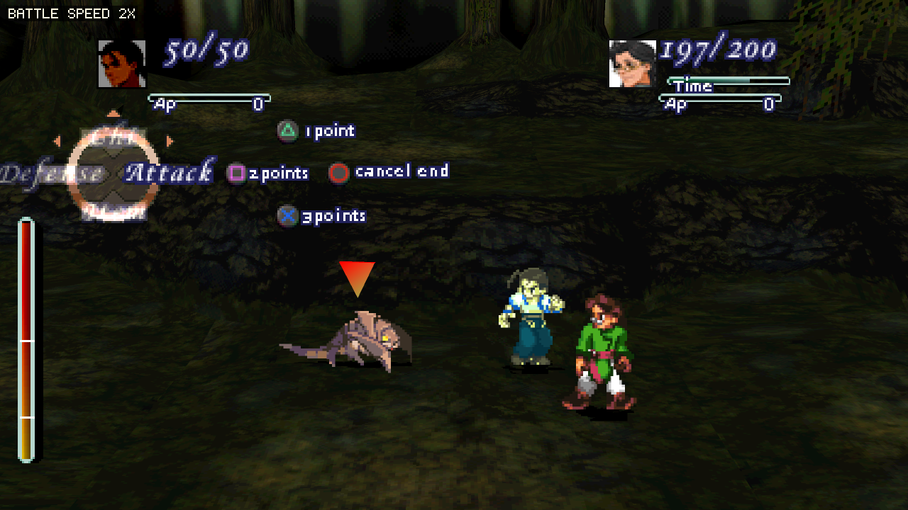

In a battle, Tab (or Select + R2) steps 1x, 2x, 4x, with a note in the corner.

## Battles

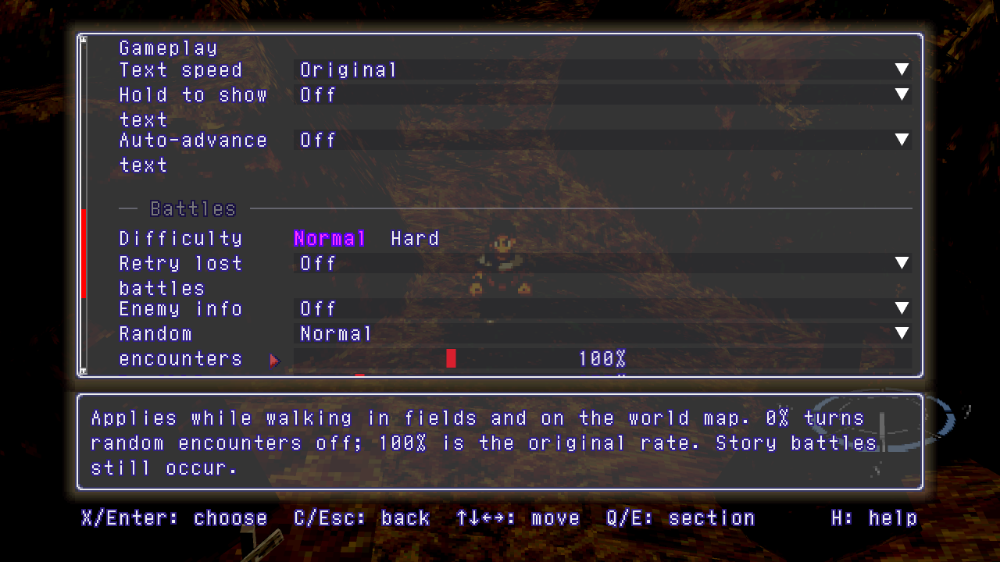

F1 > Gameplay > Battles. Advanced has a multiplier for each enemy stat (25% to
400%) and for EXP and gold, random and scripted battles apart (0% to 1000%).

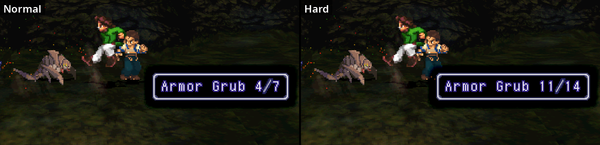

Enemy info: a lone Select press shows each enemy's name, HP and statuses.
Here the same enemy at Normal and at Hard. F1 > Gameplay > Enemy info
(Off, Always, HP once beaten) and Difficulty (Normal, Hard).

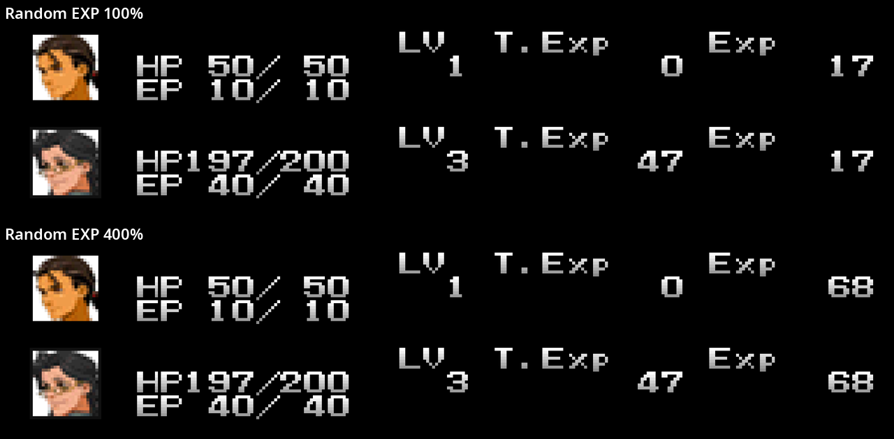

The same battle with Random EXP at 100% and 400%.
F1 > Gameplay > Advanced > Random EXP.

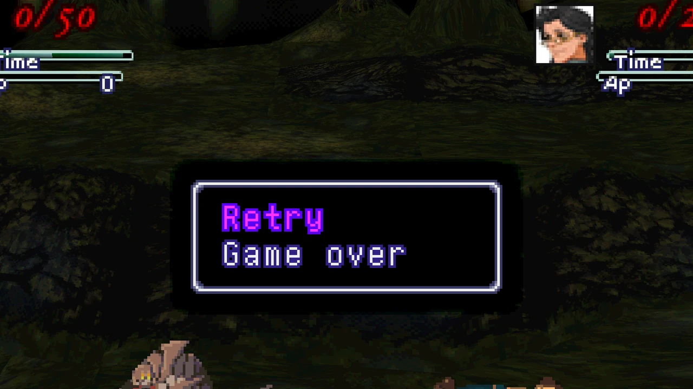

Retry lost battles: fight again from the battle's start, with the items, HP
and Gears you had. F1 > Gameplay > Retry lost battles.

Random encounters: Off, Reduced, Normal, Increased, or 0% to 400%. Story
battles still happen. F1 > Gameplay > Random encounters.

## Save states and rewind

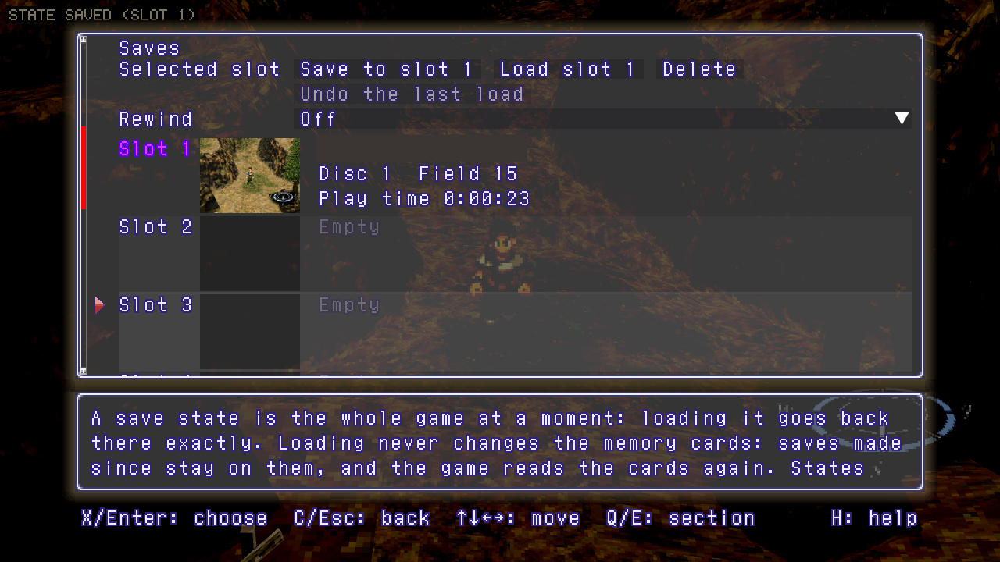

Ten slots with a picture of each. F7 saves, F8 loads, F9 and Shift+F9 choose
the slot, Shift+F8 undoes the last load. Memory cards are never changed by a
state. F1 > Saves.

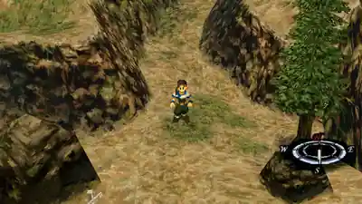

Rewind keeps the last 30 seconds: hold R, or Select + L2, to go back; let go
to play on. F1 > Saves > Rewind (Off by default).

## Gauntlet

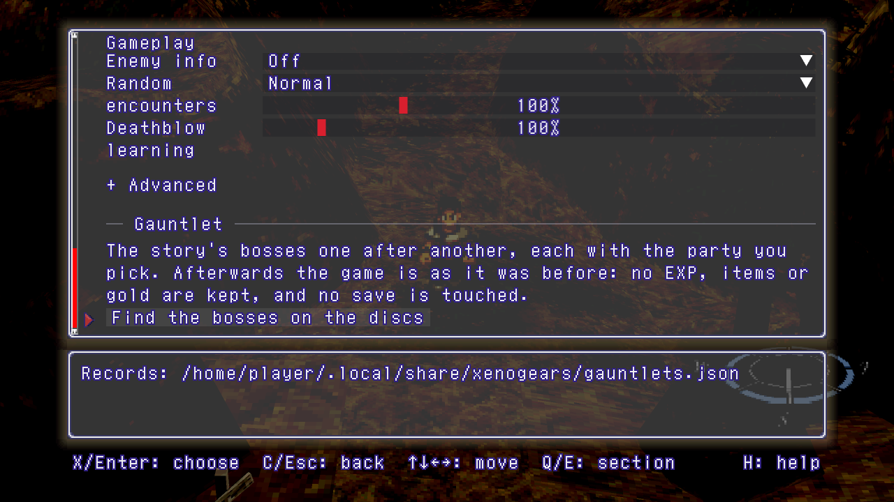

The story's bosses one after another, with the party you pick for each fight.
Afterwards the game is put back as it was. F1 > Gameplay > Gauntlet.

## Controls and audio

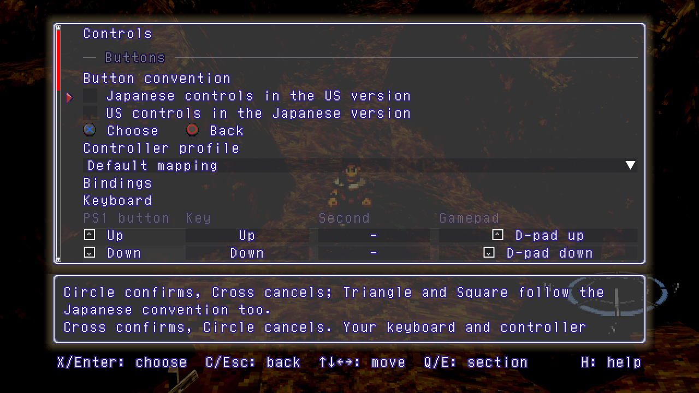

Japanese controls in the US version (Circle confirms) or US controls in the
Japanese version, key and gamepad bindings, mouse.
F1 > Controls.

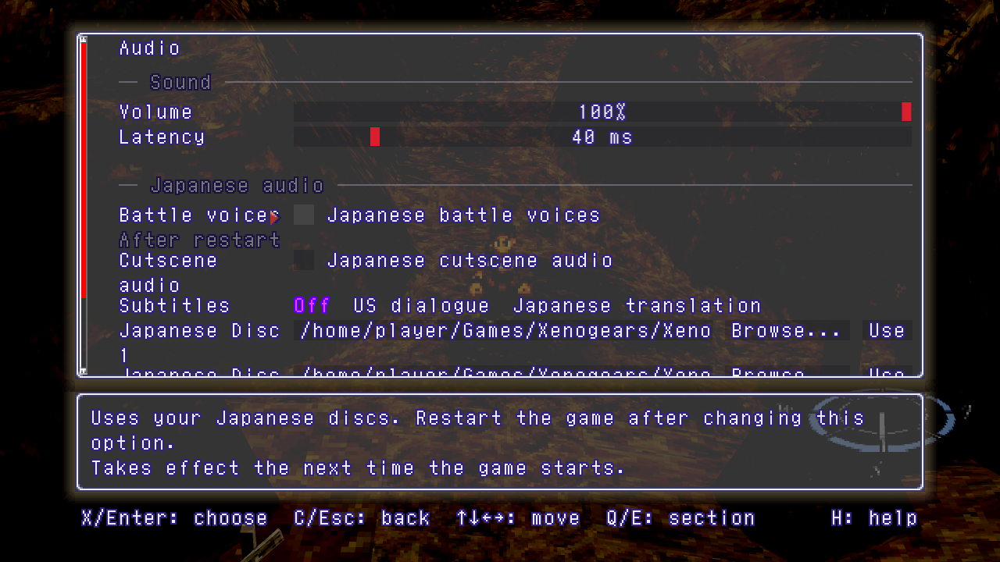

Battle voices and cutscene audio from your Japanese discs, in the US version.
F1 > Audio > Japanese audio.

## Other settings

| Setting | What it does |
|---|---|
| Speedup | Shorter memory card and loading waits; turns on smoothed motion |
| Original-game bug fixes | Fixes a list of bugs in the original game |
| Text speed | Original, 2x, 3x, 4x, 8x, Instant |
| Hold to show text | Holding confirm shows the rest of a page |
| Auto-advance text | A finished page goes on by itself after 1 to 8 s |
| Deathblow learning | Practice per attack, 0% to 1000% |
