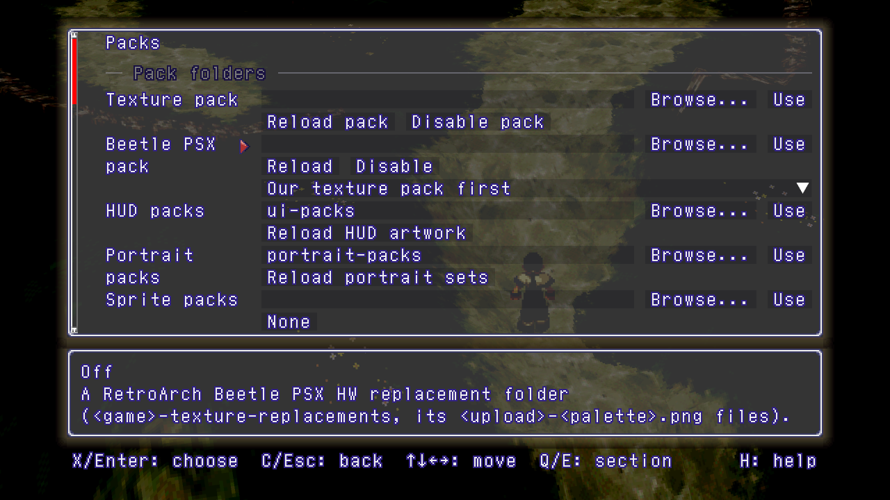
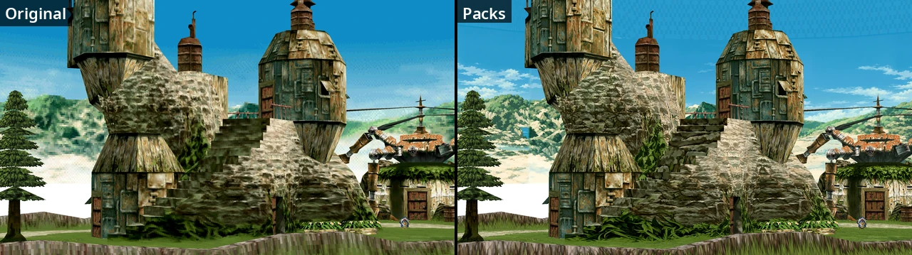
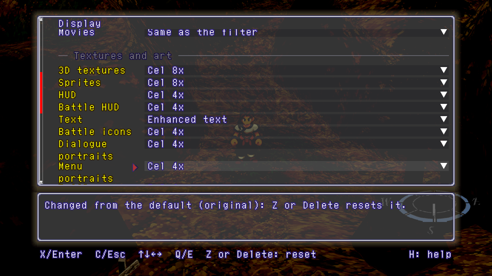
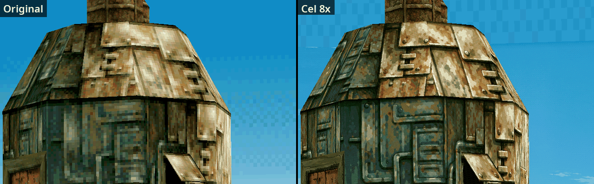
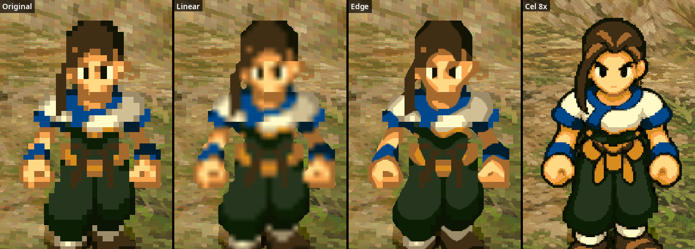
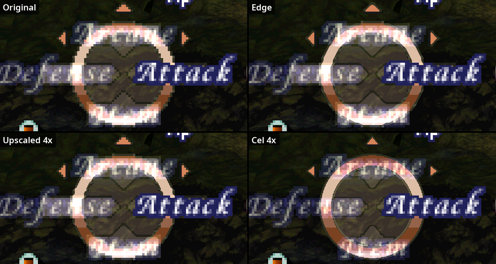
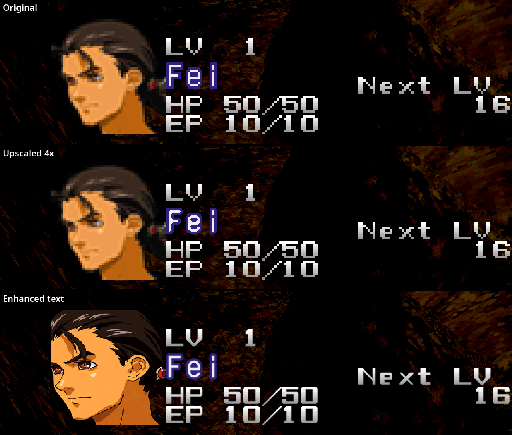
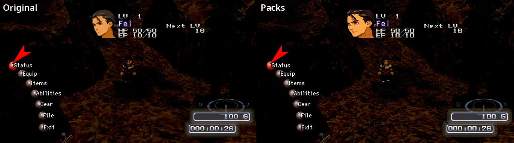
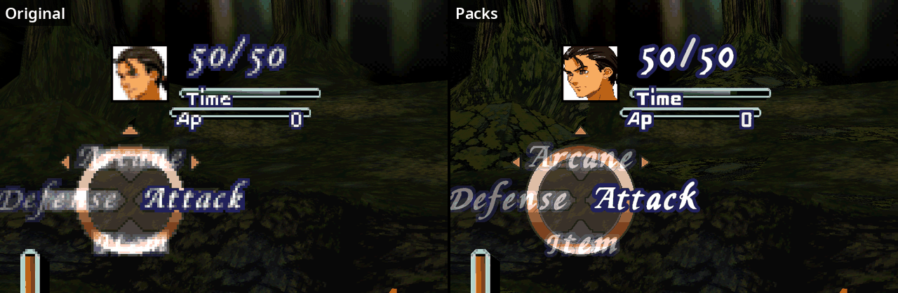
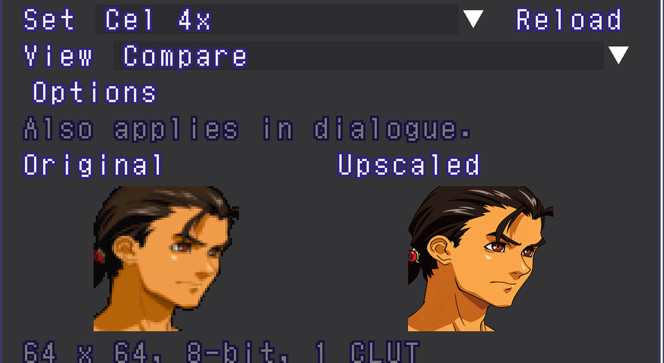

[English](packs.md) | 日本語

# パック

パックは、画面に出るゲームの絵を差し替えます。ゲームのデータには手を加えません。移植版には絵が一切同梱されていないので、パックはご自身で導入してください。パックが描かれるのは、解像度が 1x より上のときです（**F1 → 画面（Display） → 解像度（Resolution）**）。このページの画像は移植版向けに作られたパックを使っていますが、それらのパックはこのリポジトリには含まれていません。



**F1 → Packs**: ライブラリごとにフォルダーを 1 つ指定します。それぞれに Browse、使う（Use）、再読込（Reload）があります。



同じ場面を、オリジナルの絵とパックで比べたものです。

## パックを使う対象を選ぶ



絵の種類ごとに個別に選べます。3D テクスチャ（3D textures）、スプライト（Sprites）、HUD、Battle HUD、文字（Text）、Battle icons、Dialogue portraits、Menu portraits、Battle portraits です。初期値はすべてオリジナル（Original）です。**F1 → 画面 → Textures and art**。



3D テクスチャ: オリジナルと Cel 8x（フィールドのテクスチャライブラリ）。



スプライト: オリジナル、リニア（Linear）、エッジ（Edge）、Cel 8x（フィールドのスプライトライブラリ）。Cel 8x の絵は強化エンジンのものです。強化エンジンは、ライブラリの各ポーズを 1 枚の全身の絵として描きます。



Battle HUD: オリジナル、エッジ、Upscaled 4x（ゲーム本来の絵を拡大したもの）、Cel 4x（HUD のライブラリ）。



文字: オリジナル、Upscaled 4x、くっきり文字（Enhanced text。グリフのライブラリ）。ここでは、顔グラフィックセットのメニュー用の顔グラフィックも使っています。





ゲームのメニューとバトルを、オリジナルの絵とパックで比べたものです。



顔グラフィックセットは、種類（会話、メニュー、バトル）ごとに選びます。ギャラリーでは、セットとオリジナルを比べられます。**おまけ（Extras） → ビジュアル（Visuals） → ギャラリー（Gallery） → 絵（Pictures）**。

F12 キーを押すと、その場ですべての差し替えを隠し、オリジナルの絵と比べられます。

## パックの導入

| ライブラリ | 実行ファイルと同じ場所の初期フォルダー | F1 → Packs |
|---|---|---|
| テクスチャパック | `texture-packs` | テクスチャパック（Texture pack） |
| Beetle PSX HW パック | なし | Beetle PSX pack |
| HUD のアートワーク | `ui-packs` | HUD packs |
| 顔グラフィックセット | `portrait-packs` | 顔グラフィックパック（Portrait packs） |
| フィールドのスプライト | `sprite-packs` | Sprite packs |
| グリフ | `glyph-packs` | Glyph packs |

パックのフォルダーの中には、版ごとのフォルダーがあります。`SLUS-00664`（北米版）または `SLPS-01160`（日本版）です。パックを初期フォルダーに置くか **F1 → Packs** で選び、そのパックを使う絵の種類を Textures and art で設定します。

## テクスチャパックを作る

**F1 → Packs → Advanced → テクスチャ収集（Discovery）**: 空のフォルダーを選んでプレイします。ゲームが描くテクスチャが、それぞれ 1 回ずつそこに書き出されます。

- `<texel-key>-<palette-key>.png`: 1 つのパレットで描いた RGBA の画像。
- `<texel-key>.indices.png`: グレースケールのインデックスマップ（R = G = B = パレットのインデックス）。色はゲームのその時点のパレットに従います。

編集したものを、パックの版フォルダーにコピーします。差し替え画像の大きさは元の大きさの 1〜8 の整数倍で、一辺は最大 2048 ピクセルです。アルファが 64 未満は透明、64〜191 は PS1 の半透明フラグを立て、192 以上は不透明です。`pack.ini` には `name=` と `author=` を書けます。ムービーのフレームは `movies/d<disc>s<stream>/<frame>.png` に置くか、AV1 の `d<disc>s<stream>.webm` にします。

## Beetle PSX HW パック

RetroArch の Beetle PSX HW コア向けに作られたパックも使えます。**F1 → Packs → Beetle PSX pack** で、コアの `<game>-texture-replacements` フォルダーを選びます。このパックは、Textures and art でテクスチャパックを選んだ所すべてに描かれます（顔グラフィックは、それぞれの選択でテクスチャパックを選んだ所）。両方のパックに同じ絵がある場合は、この移植版のパックが優先されます。Beetle pack first で優先順位を入れ替えられます。Beetle のパックの文字の絵（メニューの名前、会話）は移植版のものと合わないため、描かれません。

## 顔グラフィックセット

```
portrait-packs/
  my-set/
    portrait.ini          name=My set
    SLUS-00664/<texel-key>-<palette-key>.png
```

正方形の RGBA PNG で、大きさは元の 64x64 の 1〜8 倍です。アルファ 0 は透明、128 は半透明フラグ、255 は不透明です。
