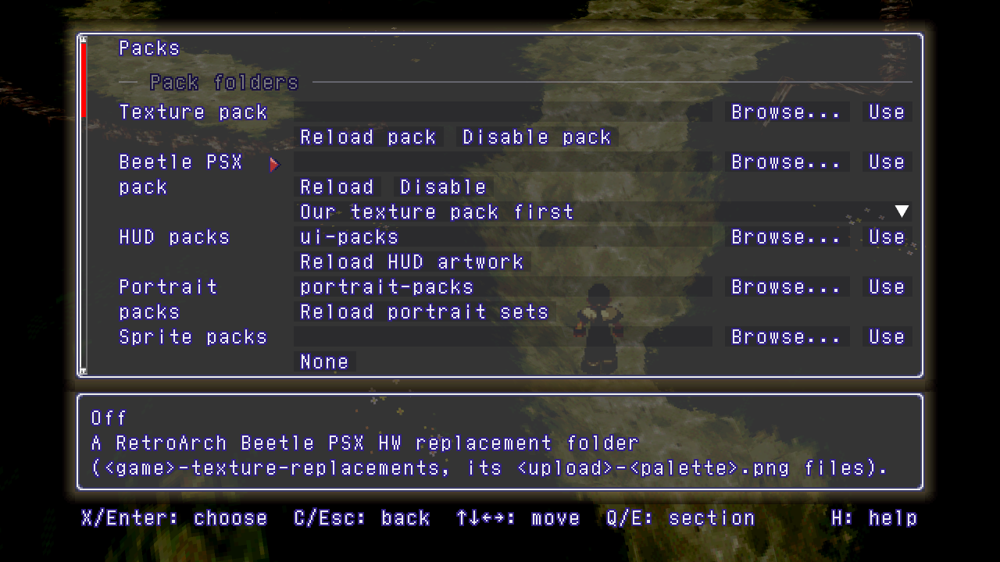

# Packs



Packs replace the game's pictures on screen without touching the game's data.
The port ships no artwork: a pack is something you make or install. Packs
are drawn only above 1x (F1 > Display > Resolution), or with Subpixel
geometry on.

## Installing a texture pack

1. Put the pack's folder anywhere. It holds a version folder: `SLUS-00664`
   for the US release, `SLPS-01160` for the Japanese one.
2. F1 > Packs > Texture pack: Browse to the folder that holds the version
   folder, then Use. A `texture-packs` folder beside the executable is used
   when none is chosen.
3. F1 > Display > Textures and art: set each kind of picture that should use
   the pack to Texture pack.

Reload pack reads the folder again after you edit it. F12 hides and shows
every replacement in place, to compare with the original art.

## Textures and art

F1 > Display > Textures and art has one choice per kind of picture: 3D
textures, Sprites, HUD, Battle HUD, Text, Battle icons, Dialogue portraits,
Menu portraits and Battle portraits. Every kind starts at Original.

| Choice | What it draws |
|---|---|
| Original | the game's pixels, sharp |
| Linear | the game's pixels, smoothed |
| Edge | the game's pixels with smoothed edges, for pixel art |
| Upscaled 2x, 4x | the game's own pixel art, enlarged 2x or 4x by a pixel-art scaler (HUD, Battle HUD, Text, Battle icons) |
| Texture pack | the texture pack's image where it has one |
| Cel, Enhanced text | art from the HUD, sprite, texture or glyph pack libraries in F1 > Packs |
| A portrait set | a set from the portrait packs folder (portraits only) |

## The pack format

A version folder holds PNGs named after the texture they replace:

- `<texel-key>-<palette-key>.png`: an RGBA image for the texture drawn with
  one palette.
- `<texel-key>.indices.png`: a greyscale index map (R = G = B = the palette
  index, alpha 255). It follows the game's live palette, so fades and palette
  swaps still work.

A replacement is the original size times a whole number from 1 to 8, at most
2048 pixels a side. In RGBA images, alpha below 64 is clear, 64 to 191 sets
the PS1's semi-transparency flag, and 192 and up is opaque. An optional
`pack.ini` in the version folder gives `name=` and `author=`.

To make one, start F1 > Packs > Advanced > Discovery with an empty folder and
play: each texture the game draws is written there once, under the names
above. Copy the ones you edit into your pack. Movie frames go in the version
folder's `movies` folder, as `d<disc>s<stream>/<frame>.png` or an AV1
`d<disc>s<stream>.webm` (F1 > Packs > Pack movies).

## Beetle PSX HW packs

Packs made for RetroArch's Beetle PSX HW core work too. F1 > Packs > Beetle
PSX pack: choose the core's replacement folder itself, for example
`Xenogears (USA) (Disc 1)-texture-replacements`, then Use.

- It is drawn wherever F1 > Display > Textures and art is set to Texture pack.
  For its portraits, set the portrait rows to Texture pack.
- When the texture pack and the Beetle pack both have an image for a
  texture, the texture pack's is drawn (Our texture pack first, the default).
  Beetle pack first swaps them.
- Text images in Beetle packs (menu names, dialogue text) never match, so
  they are not drawn.
- Textures already loaded when the pack is chosen change when the game loads
  them again, for example in the next room.

## Portraits

Portrait sets live in the portrait packs folder (`portrait-packs` beside the
executable, or F1 > Packs > Portrait packs):

```
portrait-packs/
  my-set/
    portrait.ini          name=My set, optional author=
    SLUS-00664/<texel-key>-<palette-key>.png
    SLPS-01160/<texel-key>-<palette-key>.png
```

Portraits are square RGBA PNGs, 1 to 8 times the original 64x64. Alpha 0 is
clear, 128 the semi-transparency flag, 255 opaque. Dialogue, menu and battle
portraits each pick their set in F1 > Display > Textures and art. In the
extras, Visuals > Gallery > Pictures compares a set with the originals.
