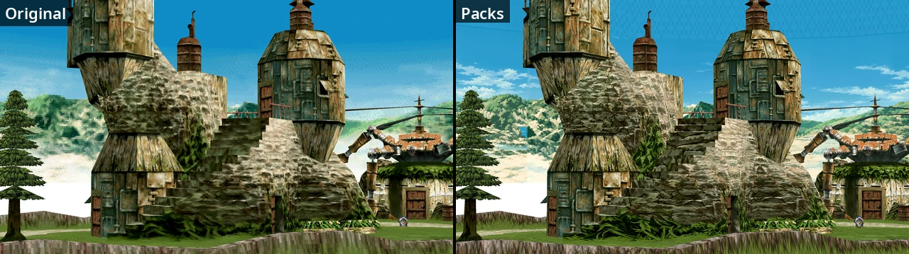
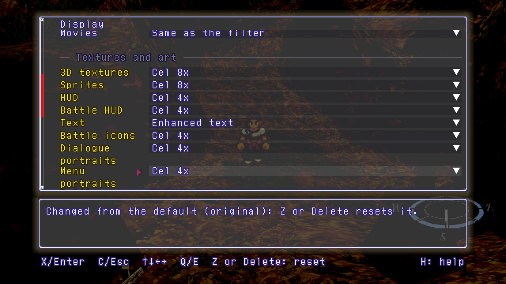
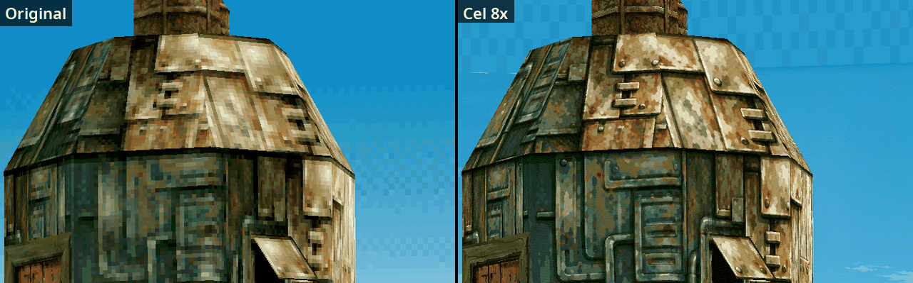
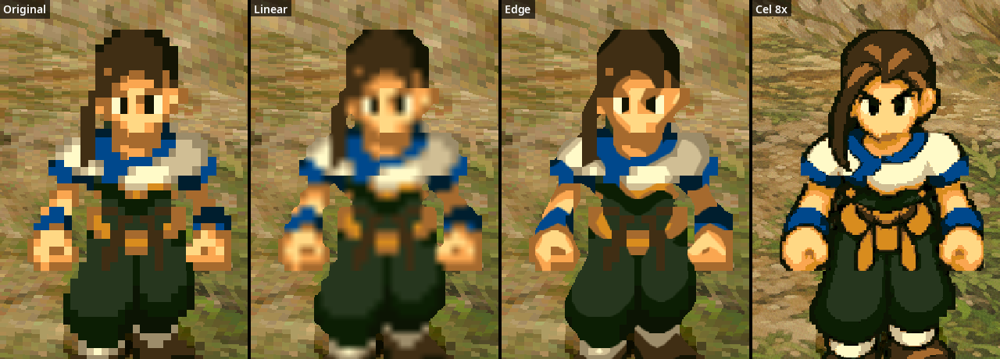
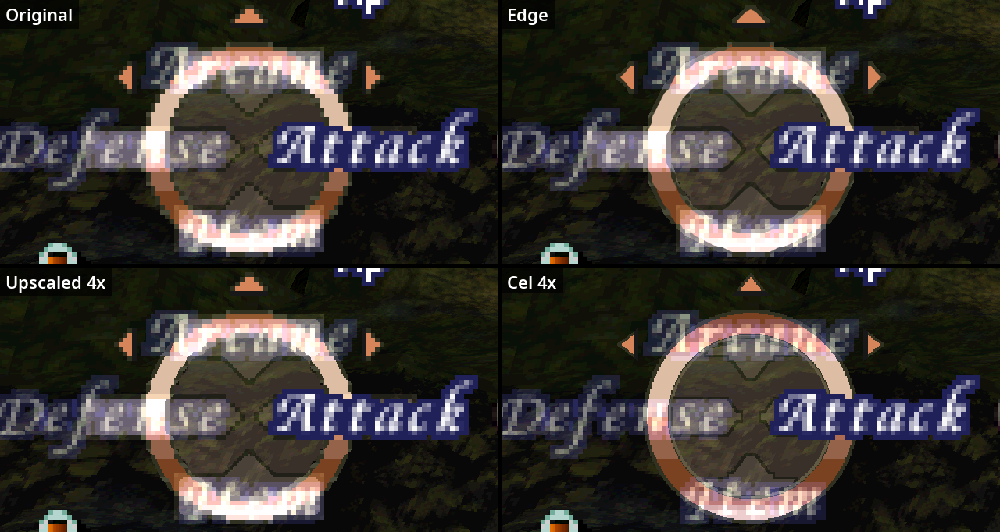
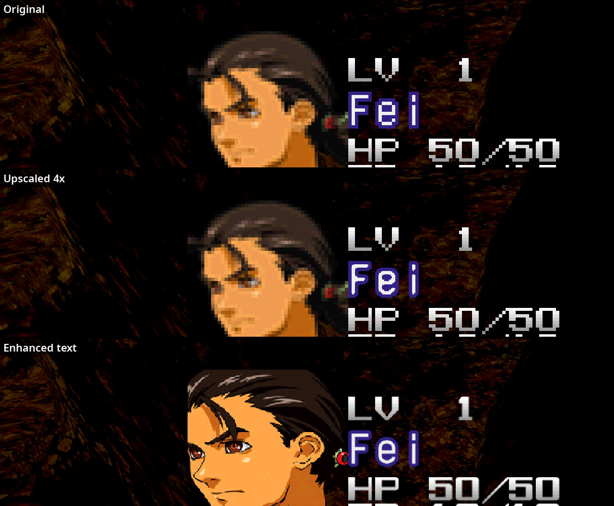
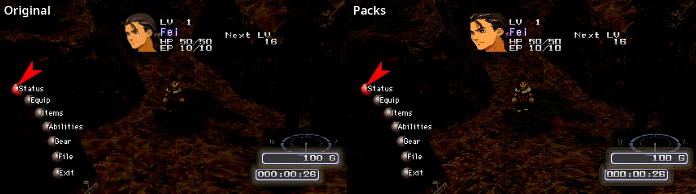
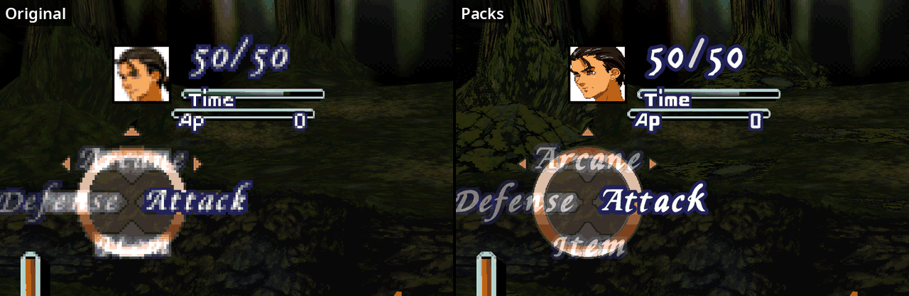
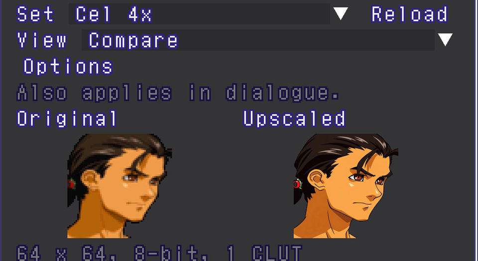

# Packs

Packs replace the game's pictures on screen. The game's data is not touched,
and the port ships no artwork: you install packs yourself. They are drawn
above 1x (F1 > Display > Resolution). The pictures on this page use packs
made for the port; they are not part of this repository.


F1 > Packs: one folder for each library, with Browse, Use and Reload.



The same moment with the original art and with packs.

## Choosing what uses a pack



Each kind of picture has its own choice: 3D textures, Sprites, HUD, Battle
HUD, Text, Battle icons, Dialogue portraits, Menu portraits, Battle portraits.
All start at Original. F1 > Display > Textures and art.



3D textures: Original and Cel 8x (the field texture library).



Sprites: Original, Linear, Edge and Cel 8x (the field sprite library).



Battle HUD: Original, Edge, Upscaled 4x (the game's own art, enlarged) and
Cel 4x (the HUD library).



Text: Original, Upscaled 4x and Enhanced text (the glyph library), here with a
menu portrait from a portrait set.





The game's menu and a battle, original art and packs.



Portrait sets are chosen per kind (dialogue, menu, battle). The gallery
compares a set with the original. Extras > Visuals > Gallery > Pictures.

F12 hides every replacement in place, to compare with the original art.

## Installing a pack

| Library | Default folder beside the executable | F1 > Packs |
|---|---|---|
| Texture pack | `texture-packs` | Texture pack |
| Beetle PSX HW pack | none | Beetle PSX pack |
| HUD artwork | `ui-packs` | HUD packs |
| Portrait sets | `portrait-packs` | Portrait packs |
| Field sprites | `sprite-packs` | Sprite packs |
| Glyphs | `glyph-packs` | Glyph packs |

A pack folder holds a version folder: `SLUS-00664` (US) or `SLPS-01160`
(Japanese). Put it in the default folder, or choose it in F1 > Packs, then set
the kinds of picture that should use it in Textures and art.

## Making a texture pack

F1 > Packs > Advanced > Discovery: choose an empty folder and play. Each
texture the game draws is written there once:

- `<texel-key>-<palette-key>.png`: an RGBA picture for one palette;
- `<texel-key>.indices.png`: a greyscale index map (R = G = B = the palette
  index), which follows the game's live palette.

Copy the ones you edit into your pack's version folder. A replacement is the
original size times a whole number from 1 to 8, at most 2048 pixels a side.
Alpha below 64 is clear, 64 to 191 sets the PS1's semi-transparency flag,
192 and up is opaque. `pack.ini` can give `name=` and `author=`. Movie frames
go in `movies/d<disc>s<stream>/<frame>.png`, or an AV1 `d<disc>s<stream>.webm`.

## Beetle PSX HW packs

Packs made for RetroArch's Beetle PSX HW core work as well. Choose the core's
`<game>-texture-replacements` folder in F1 > Packs > Beetle PSX pack. It is
drawn wherever Textures and art is set to Texture pack (portraits: their
Texture pack choice). Where both packs have a picture, ours is drawn first;
Beetle pack first swaps them. Text pictures from Beetle packs (menu names,
dialogue) don't match the port's and are not drawn.

## Portrait sets

```
portrait-packs/
  my-set/
    portrait.ini          name=My set
    SLUS-00664/<texel-key>-<palette-key>.png
```

Square RGBA PNGs, 1 to 8 times the original 64x64. Alpha 0 is clear, 128 the
semi-transparency flag, 255 opaque.
