[English](translations.md) | 日本語

# 翻訳されたテキストで遊ぶ

ダウンロードできる北米版は英語で遊べます。お手持ちの元の北米版ディスクからゲームを起動し、テキストの読み込み元として翻訳を選んでください。パッチを当てたイメージから読むのはテキストだけです。v2026.11.20 以降では、イタリア語、スペイン語、Helsionium のドイツ語、Atelier のフランス語を、パッチを当てたイメージからそのまま使えます。

## 翻訳を選ぶ

**F1 → システム（System） → Language and text → 言語（Language）** を開きます。ディスクの言語、もう一方の地域版（そのディスクが見つかった場合）、登録したイメージの組、インストールしたテキストパックのどれかを選びます。選んだ言語は、会話、バトル、名前、メニューと、そこで絵として描かれた文字に使われます。選択はすぐに保存されます。変更を確かめるには、新しい会話を開くか、メニューを開き直すか、新しいバトルを始めてください。

パッチを当てたイメージを登録するには、**翻訳の読み込み元（Translation sources） → テキストイメージ（Text images）** を開き、イメージのパスと翻訳の名前を入力してから **このディスクを登録（Remember these images）** を選びます。名前を付けた組は複数登録できます。使えるディスクが 1 枚だけの組は、一覧でそのことが示されます。**種類別のテキスト設定（Individual text settings）** では読み込み元を組み合わせられ、そのときセレクターには **カスタム（Custom）** と表示されます。**This menu** の **設定画面の言語（Interface language）** で、F1 メニューとおまけの言語が変わります。

1. 翻訳チームのパッチを、北米版ディスクイメージ 2 枚の**コピー**に当てます。ディスクの設定では、元の 2 枚を選んだままにしておきます。
2. **F1 → システム → Language and text → 翻訳の読み込み元 → テキストイメージ** を開きます。パッチを当てたディスク 1 とディスク 2 のイメージのパスと翻訳の名前を入力し、**このディスクを登録** を選びます。
3. **言語** でその名前を選びます。メニューとバトルの文字を確かめるには、ゲームのメニューを開き直すか、新しいバトルに入ってください。

**Atelier Français 1.1** では、パッチャーの `Patched` または `Undub_patched` フォルダーにある CUE または BIN をそのまま入力します。移植版は、フランス語のテキスト、フォント、バトルのコマンドホイールをそこから直接読み込みます。[Atelier のパッチと手順](https://ateliertraduction.forumgaming.fr/t51-mise-a-jour-de-xenogears-en-v1-1)

**Helsionium のドイツ語**では、xdelta を北米版ディスク 2 枚のコピーに当てます。ディスク 1 はバージョン 1.03-final-cd1fix、ディスク 2 はバージョン 1.03-final です。それらのイメージを **テキストイメージ** に入力して名前を付け、**言語** でその名前を選びます。移植版は、そこからドイツ語のテキストとフォントを読みます。ムービーは元の映像のままです。[Helsionium のパッチと手順](https://xenogears.helsionium.eu/deutsch/)

北米版ビルドで日本語のゲームテキストを読むには、お手持ちの日本版ディスクを用意し、**言語** で **日本語（Japanese）** を選びます。インストールしたテキストパックは名前で一覧に出ます。パックには独自のムービー字幕を入れることができます。イメージパッチの場合、移植版は元のムービー映像を使うので、映像に初めから入っている文字もそのままです。読み込み元に字幕トラックがないときは、セレクターが別付けの字幕をオフにします。日本語版のバトルボイスとムービー音声は、**F1 → サウンド（Audio）** で別に設定します。[サウンドの設定](gameplay-ja.md#controls-and-audio)

## v2026.11.20 より前のダウンロード版

v2026.11.17 には **言語** のセレクターがなく、Atelier のフランス語のイメージを直接読むこともできません。

イタリア語やスペイン語のように、パッチを当てたイメージからそのまま使える翻訳では、次の手順に従います。

1. 翻訳チームのパッチを、北米版ディスクイメージ 2 枚の**コピー**に当てます。ディスクの設定では、元の 2 枚を選んだままにしておきます。
2. **F1 → システム → Language and text → テキストイメージ** を開きます。パッチを当てたディスク 1 とディスク 2 のイメージのパスを入力し、それぞれ **使う（Use）** を選びます。
3. **会話（Dialogue）**、**バトルの文字（Battle text）**、**ゲームのメニュー（Game menus）**、**名前・アイテム（Names, items）** で **テキストイメージ（Text image）** を選びます。メニューとバトルで絵として描かれた文字には、**文字入りの絵も（Pictures with text too）** を有効にします。それらの文字を確かめるには、ゲームのメニューを開き直すか、新しいバトルに入ってください。

そのセクションの **言語** の行は、F1 メニューとおまけの表示を英語と日本語で切り替えます。北米版ビルドで日本語のゲームテキストを読むには、お手持ちの日本版ディスクを用意し、ゲームテキストの各行で **日本語** を選びます。**ディスク（Disc）** を選ぶと、その行は実行中のゲーム本来のテキストに戻ります。

<a id="french-with-atelier-traduction-11"></a>
### フランス語（Atelier Traduction 1.1）

1. Atelier の 1.1 パッチを、北米版ディスク 2 枚のコピーに当てます。パッチャーが作る `Patched` フォルダーは残しておきます。同時に作られる `Undub_patched` フォルダーもテキストには使えます。[Atelier のパッチと手順](https://ateliertraduction.forumgaming.fr/t51-mise-a-jour-de-xenogears-en-v1-1)
2. 2 つの Python ファイルを同じフォルダーに保存します。北米版のオリジナルエンジンの実行ファイル、元の北米版ディスク 1、パッチャーの出力フォルダーを指定してヘルパーを実行します。例のパスはご自分のものに置き換えてください。一時領域として約 1.5 GB を空けておいてください。ヘルパーはパッチを当てた 2 枚のイメージを確認し、ゲームを使って、フランス語のテキスト、フォント、バトルの文字を収めた個人用パックを書き出します。[フランス語パックのヘルパー](https://raw.githubusercontent.com/EtherAura/xenogears-pc/main/tools/atelier_text_pack.py) · [ディスクリーダー（xenofs.py）](https://raw.githubusercontent.com/EtherAura/xenogears-pc/main/tools/xenofs.py)

   ```sh
   python3 atelier_text_pack.py --game "/path/to/bin/xenogears" --retail "/path/to/original Disc 1.cue" --french "/path/to/Patched"
   ```

3. 元の北米版ディスクからゲームを起動します。**F1 → システム → Language and text** で、会話、バトルの文字、ゲームのメニュー、名前・アイテムに **Atelier Français 1.1** を選びます。メニューとバトルには **文字入りの絵も** を有効にします。

フランス語のコマンドホイールに **Attack** と表示されたままなら、古い `atelier-fr` フォルダーをパックのディレクトリの外へ移し、更新されたヘルパーを実行してから新しいバトルを始めてください。

v2026.11.17 でフランス語の BIN を直接選ぶと、フェイのせりふは英語のままです。このパッチはファイルテーブルの未使用のスロットに追加のデータを入れており、このリリースはそれを無効なファイル項目として読みます。ヘルパーは一時コピーの中でこれらのスロットに対処します。v2026.11.20 以降は Atelier のイメージを見分けて、これらのスロットに自分で対処します。[イメージを直接選んだ結果](img/translations/field14-fr.png)

## どの翻訳が使えるか

以下の結果は **v2026.11.17 の Linux x86-64 版ダウンロードのオリジナルエンジン** で得たものです。テストの範囲は、各ディスクの会話とステータス画面 1 つ、それにディスク 1 でのバトル 1 回です。Windows、強化エンジン、ムービー字幕、最後までの通しプレイはこのテストに含まれていません。[テストしたリリース](https://github.com/EtherAura/xenogears-pc/releases/tag/v2026.11.17)

| 翻訳 | このビルドでの結果 |
|---|---|
| イタリア語 · SadNES cITy 1.2.1 | 両ディスクでイタリア語の会話と装備のテキストが表示されました。バトルでは **Attacco** と **Tempo** が表示されました。ステータスのラベルの一部は英語のままでした。[パッチと手順](https://www.sadnescity.it/traduzioni/xeno/xeno.php) |
| スペイン語 · Romhack Hispano v1 | テキストとグラフィックを訳した版で、両ディスクにスペイン語の会話、メニューのラベル、装備の名前が表示されました。バトルのコマンドは **Atacar** でした。ステータスのラベルの一部は英語のままでした。[パッチと手順](https://xenogears.romhackhispano.org/traduccion.html) |
| ドイツ語 · Helsionium 1.03-final-cd1fix | イタリア語やスペイン語のパッチと同じく、両ディスクの xdelta をテキストイメージとして読みます。ディスク 1 は 1.03-final-cd1fix、ディスク 2 は 1.03-final です。[パッチと手順](https://xenogears.helsionium.eu/deutsch/) |
| 英語 · Perfect Works Build 0.11.4 | テストしたテキストを使うには、**`story_mode_script`** プリセットでパッチを当てたご自分のイメージを使ってください。ディスク 2 で、改訂された英語のナレーションが表示されました。6 つの `all_*` プリセットはすべて、両ディスクで検証に失敗しました。`bug_fixes` と `story_mode` のイメージは検証に通りましたが、会話はテストしていません。テキストイメージを選んでも、ゲームプレイのルールは PC 版のエンジンが決めたままです。[Perfect Works のリリース](https://github.com/PWBuild-Team/Perfect_Works_Build/releases/tag/0.11.4) |
| フランス語 · Atelier Traduction 1.1 | 個人用パックで、両ディスクにフランス語の会話と装備のテキストが表示されました。更新されたヘルパーでは、ディスク 1 のバトルのコマンドホイールに **Attaque**、ゲージに **Temps** と表示されます。[フランス語の設定](#french-with-atelier-traduction-11) |
| ブラジルポルトガル語 · TransXeno | このチームの翻訳との互換性は**未確認**です。別に用意した 2 行だけのポルトガル語テストパックでは、足りないグリフをパックが補うと、アクセント付きの会話が表示されました。北米版の標準フォントでは、2 行とも英語に戻りました。[TransXeno の翻訳のスクリーンショット](https://transxeno.blogspot.com/2010/06/novas-imagens-da-traducao.html) |

## スクリーンショットの比較

PC のスクリーンショットは公開中の Linux 版オリジナルエンジンのビルドで撮り、各場面を言語どうしで同じフレームにそろえています。PS1 のバトルのスクリーンショットは、Atelier のパッチを当てたディスクで同じコマンドホイールを写したものです。ディスク 2 のナレーションにはストーリーのネタバレがあります。

### ディスク 1 の会話

フェイのせりふは、北米製品版では「Whew! That about does it...」、Atelier のパックでは「Fiou ! Ça devrait suffire...」です。

| 北米製品版 | Atelier Français 1.1 パック |
|---|---|
| 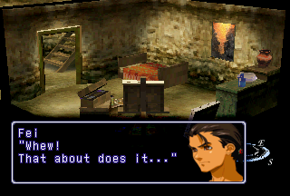 | 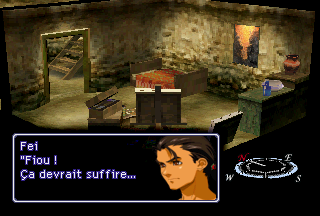 |

| SadNES cITy イタリア語 | Romhack Hispano スペイン語 |
|---|---|
| 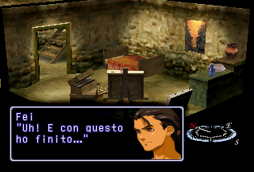 | 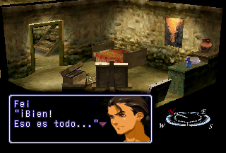 |

### バトルとステータス

ディスク 1 のバトルのコマンドホイールでは、フランス語のコマンド **Attaque** と **Temps** のゲージが、Beetle PSX で動かした Atelier のパッチ済みディスク 1 と一致しています。イタリア語のコマンドは **Attacco**、スペイン語のコマンドは **Atacar** です。

| PC v2026.11.17 の Atelier パック | PS1 で動かした Atelier のパッチ済みディスク 1 |
|---|---|
|  | 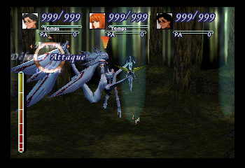 |

| イタリア語のバトルコマンド | スペイン語のバトルコマンド |
|---|---|
|  | 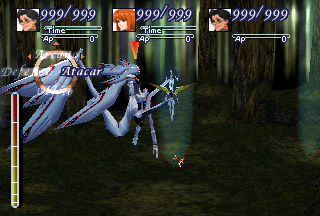 |

| イタリア語のステータス画面 | スペイン語のステータス画面 | フランス語のステータス画面 |
|---|---|---|
| 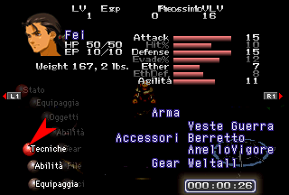 | 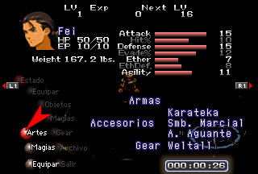 | 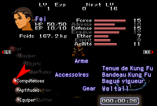 |

### ディスク 2 のナレーション

ナレーションの同じ場面で、Perfect Works の `story_mode_script` プリセットによる言い回しの変更と、フランス語、イタリア語、スペイン語の訳文を見比べられます。

| 北米製品版 | Atelier Français 1.1 パック | Perfect Works 英語版 |
|---|---|---|
| 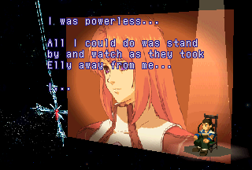 | 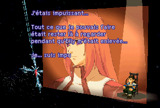 |  |

| SadNES cITy イタリア語 | Romhack Hispano スペイン語 |
|---|---|
| 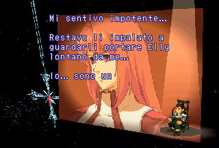 | 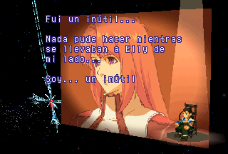 |

### ブラジルポルトガル語のフォントの確認

どちらも同じ 2 行の診断用パックを使っています。北米版の標準フォントでは英語に戻ります。アクセント付きのグリフを補うと、ポルトガル語の行が表示されます。TransXeno そのものはテストしていません。

| 北米版の標準フォント | アクセント付きグリフ入りのパック |
|---|---|
|  | 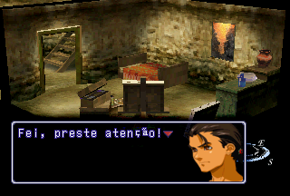 |

## トラブルシューティング

ゲーム内の文が英語のまま表示されるなら、その文の種類に当たるゲームテキストの行の下にある状態表示を確認してください。移植版は、読み込み元を読めないときや、置き換えるテキストがその場面のスクリプトに合わないときは、実行中のディスクのテキストをそのまま使います。Linux では、次のコマンドでパッチを当てた 2 枚のイメージを確認できます。

```sh
xenogears --verify-discs "/path/to/patched-disc-1.cue" "/path/to/patched-disc-2.cue"
```

チェックに通れば、イメージの識別とファイルテーブルは確認できています。翻訳そのものを確かめるには、言い回しが変わっているとわかっている場面を開いてください。
