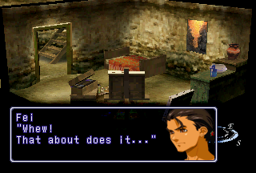
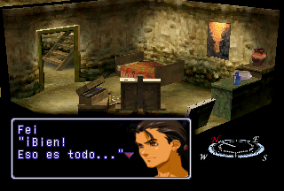
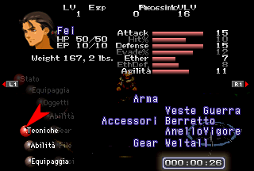
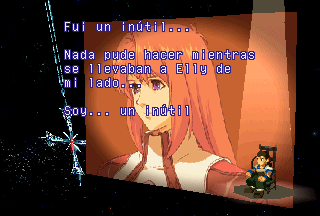

# Playing with translated text

The US download plays in English. To use a fan translation, start the game
from your original US disc images and give the port a second, patched pair
as its text source. You can choose the source separately for dialogue,
battle text, game menus and item names.

## Set up a translation

1. Apply the translation team's patch to **copies** of both US disc images.
   Keep your original pair selected in disc setup.
2. Open **F1 → System → Language and text → Text images**. Enter the patched
   Disc 1 and Disc 2 image paths and select **Use** for each.
3. Choose **Text image** for **Dialogue**, **Battle text**, **Game menus**
   and **Names, items**. For menu and battle labels drawn as pictures,
   enable **Pictures with text too**. Reopen the game menu or enter a new
   battle to see those labels.

The **Language** row in the same section switches F1 and Extras between
English and Japanese in the stock download. To read
Japanese game text in the US build, supply your Japanese discs and choose
**Japanese** in the game text rows. You can also choose an installed text
pack by name. **Disc** restores the running game's own text for that row.
Japanese battle voices and movie audio have separate settings under
**F1 → Audio**. [Audio settings](gameplay.md#controls-and-audio)

## Which translations work?

These results are from the **Original engine in the Linux x86-64 download
of v2026.11.17**. Testing covered dialogue and a status screen on each disc,
plus a Disc 1 battle. Windows, Enhanced, movie subtitles and a complete
playthrough were outside this test. [Tested release](https://github.com/EtherAura/xenogears-pc/releases/tag/v2026.11.17)

| Translation | Result on this build |
|---|---|
| Italian · SadNES cITy 1.2.1 | Both discs showed Italian dialogue and equipment text. The battle showed **Attacco** and **Tempo**. Some status labels stayed in English. [Patch and instructions](https://www.sadnescity.it/traduzioni/xeno/xeno.php) |
| Spanish · Romhack Hispano v1 | The text-and-graphics edition showed Spanish dialogue, menu labels and equipment names on both discs. The battle command read **Atacar**. Some status labels stayed in English. [Patch and instructions](https://xenogears.romhackhispano.org/traduccion.html) |
| English · Perfect Works Build 0.11.4 | Use your own images patched with the **`story_mode_script`** preset for the tested text option. Revised English narration appeared on Disc 2. All six `all_*` presets failed verification on both discs. The `bug_fixes` and `story_mode` images passed verification, but their dialogue was untested. Selecting a text image leaves gameplay rules under the control of the PC engine. [Perfect Works release](https://github.com/PWBuild-Team/Perfect_Works_Build/releases/tag/0.11.4) |
| French · Atelier Traduction 1.1 | The port rejected both patched images because a file-table entry extended beyond the image. The optional Japanese-voice images failed the same check. With the French text images selected, all five sampled scenes kept their original English text. [Team's patch notes](https://ateliertraduction.forumgaming.fr/t51-mise-a-jour-de-xenogears-en-v1-1) |
| Brazilian Portuguese · TransXeno | Compatibility with the team's translation is **unverified**. In a separate two-line Portuguese test pack, accented dialogue appeared when the pack supplied the missing glyphs. With the stock US font, both lines fell back to English. [TransXeno's translation screenshots](https://transxeno.blogspot.com/2010/06/novas-imagens-da-traducao.html) |

## Screenshot comparisons

Each pair shows the same frame from the published Linux Original build. The Disc 2 narration contains a story spoiler.

### Disc 1 dialogue

Fei speaks in the same room on all four runs. The French images failed verification, so that run shows the original English line.

| US retail | Atelier French selected |
|---|---|
|  |  |

| SadNES cITy Italian | Romhack Hispano Spanish |
|---|---|
|  |  |

### Battle and status

The Disc 1 battle wheel reads **Attacco** in Italian and **Atacar** in Spanish. On the status screen, the equipment names change while some stat labels stay in English.

| Italian battle commands | Spanish battle commands |
|---|---|
|  |  |

| Italian status screen | Spanish status screen |
|---|---|
|  |  |

### Disc 2 narration

The same moment in the narration shows a wording change with the Perfect Works `story_mode_script` preset and translated lines with the Italian and Spanish patches.

| US retail | Perfect Works English |
|---|---|
|  |  |

| SadNES cITy Italian | Romhack Hispano Spanish |
|---|---|
|  |  |

### Brazilian Portuguese font check

Both runs use the same two-line diagnostic pack. The stock US font falls back to English. Supplying the accented glyphs makes the Portuguese line visible. TransXeno itself was untested.

| Stock US font | Pack with accented glyphs |
|---|---|
|  |  |

## Troubleshooting

If a line stays in English, check the status under its game text row.
The port keeps the running disc's text when it cannot read the source or
when the replacement does not fit the scene's script. On Linux, you can
check both patched images with this command.

```sh
xenogears --verify-discs "/path/to/patched-disc-1.cue" "/path/to/patched-disc-2.cue"
```

A successful check confirms the images' identities and file tables. To
confirm the translation, open a scene with a known wording change.
