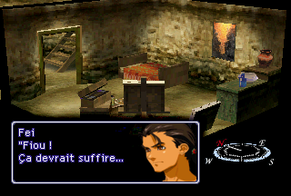
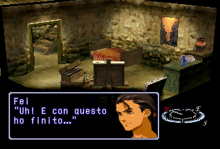
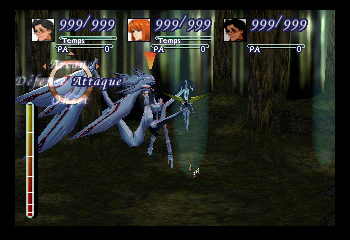
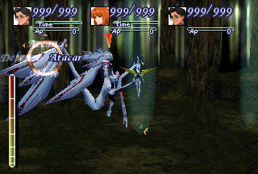
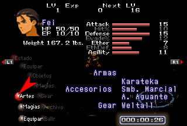
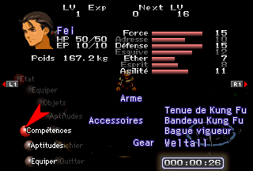
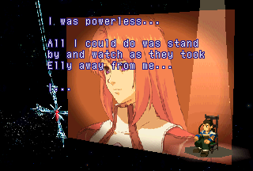
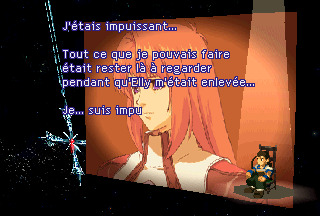
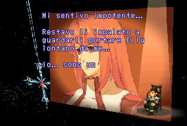
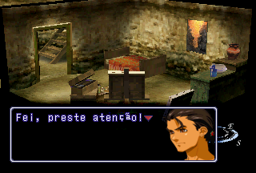

English | [日本語](translations-ja.md)

# Playing with translated text

The US download plays in English. Start the game from your original US
discs and select a translation as its text source; the patched images are
read only for their text. Italian, Spanish and Atelier's French work straight
from patched images in v2026.11.20 and later.

## Choose a translation

Open **F1 → System → Language and text → Language**. Choose the disc
language, the other region if its discs were found, a saved image pair, or
an installed text pack. This applies to dialogue, battles, names, menus and
their picture labels. The choice is saved immediately. Open a new dialogue,
reopen the menu or start a new battle to see the change.

To register patched images, open **Translation sources → Text images**, enter
their paths and a translation name, then choose **Remember these images**.
You can keep several named pairs. A single usable disc is labelled in the
list. **Individual text settings** lets you mix sources and shows **Custom**
in the selector. **Interface language** under **This menu** changes F1 and
Extras.

1. Apply the translation team's patch to **copies** of both US disc images.
   Keep your original pair selected in disc setup.
2. Open **F1 → System → Language and text → Translation sources → Text
   images**. Enter the patched Disc 1 and Disc 2 image paths and a
   translation name, then choose **Remember these images**.
3. Choose that name under **Language**. Reopen the game menu or enter a new
   battle to see the menu and battle labels.

For **Atelier Français 1.1**, enter the original CUEs or BINs from the
patcher’s `Patched` or `Undub_patched` folder. The port reads the French
text, font and battle wheel directly from them. [Atelier’s patch and instructions](https://ateliertraduction.forumgaming.fr/t51-mise-a-jour-de-xenogears-en-v1-1)

To read Japanese game text in the US build, supply your Japanese discs and
choose **Japanese** under **Language**. An installed text pack is listed by
its name. A pack can supply its own movie captions. For image patches the
port keeps the original movie video, including any text already in that
video. The selector turns separate subtitles off when the source has no
track. Japanese battle voices and movie audio have separate settings under
**F1 → Audio**. [Audio settings](gameplay.md#controls-and-audio)

## Downloads before v2026.11.20

v2026.11.17 has no **Language** selector and cannot read Atelier's French
images directly.

For a translation that works directly from patched images, such as Italian
or Spanish:

1. Apply the translation team's patch to **copies** of both US disc images.
   Keep your original pair selected in disc setup.
2. Open **F1 → System → Language and text → Text images**. Enter the patched
   Disc 1 and Disc 2 image paths and select **Use** for each.
3. Choose **Text image** for **Dialogue**, **Battle text**, **Game menus**
   and **Names, items**. For menu and battle labels drawn as pictures,
   enable **Pictures with text too**. Reopen the game menu or enter a new
   battle to see those labels.

The **Language** row in that section switches F1 and Extras between English
and Japanese. To read Japanese game text in the US build, supply your
Japanese discs and choose **Japanese** in the game text rows. **Disc**
restores the running game's own text for that row.

### French with Atelier Traduction 1.1

1. Apply Atelier’s 1.1 patch to copies of both US discs. Keep the
   `Patched` folder that the patcher produces. Its `Undub_patched`
   folder also works for text. [Atelier’s patch and instructions](https://ateliertraduction.forumgaming.fr/t51-mise-a-jour-de-xenogears-en-v1-1)
2. Save both Python files in the same folder. Run the helper with the
   Original US game executable, your original US Disc 1 and the patcher’s output folder.
   Replace the example paths with yours. Allow about 1.5 GB of temporary
   space. The helper checks both patched images and uses the game to
   export a personal pack with the French text, font and battle labels.
   [French pack helper](https://raw.githubusercontent.com/EtherAura/xenogears-pc/main/tools/atelier_text_pack.py) · [Disc reader (xenofs.py)](https://raw.githubusercontent.com/EtherAura/xenogears-pc/main/tools/xenofs.py)

   ```sh
   python3 atelier_text_pack.py --game "/path/to/bin/xenogears" --retail "/path/to/original Disc 1.cue" --french "/path/to/Patched"
   ```

3. Launch the game from your original US discs. In **F1 → System →
   Language and text**, choose **Atelier Français 1.1** for Dialogue,
   Battle text, Game menus and Names/items. Enable **Pictures with text
   too** for menus and battles.

If your French wheel still says **Attack**, move the old `atelier-fr` folder
outside your packs directory, run the updated helper and start a new battle.

Selecting the French BINs directly in v2026.11.17 leaves Fei speaking
English. The patch stores extra data in unused file-table slots, which
that release reads as invalid file entries. The helper accounts for those
slots in temporary copies; v2026.11.20 and later recognise Atelier's
images and account for those slots themselves. [Direct-image result](img/translations/field14-fr.png)

## Which translations work?

These results are from the **Original engine in the Linux x86-64 download
of v2026.11.17**. Testing covered dialogue and a status screen on each disc,
plus a Disc 1 battle. Windows, Enhanced, movie subtitles and a complete
playthrough were outside this test. [Tested release](https://github.com/EtherAura/xenogears-pc/releases/tag/v2026.11.17)

| Translation | Result on this build |
|---|---|
| Italian · SadNES cITy 1.2.1 | Both discs showed Italian dialogue and equipment text. The battle showed **Attacco** and **Tempo**. Some status labels stayed in English. [Patch and instructions](https://www.sadnescity.it/traduzioni/xeno/xeno.php) |
| Spanish · Romhack Hispano v1 | The text-and-graphics edition showed Spanish dialogue, menu labels and equipment names on both discs. The battle command read **Atacar**. Some status labels stayed in English. [Patch and instructions](https://xenogears.romhackhispano.org/traduccion.html) |
| English · Perfect Works Build 0.11.4 | Use your own images patched with the **`story_mode_script`** preset for the tested text option. Revised English narration appeared on Disc 2. All six `all_*` presets failed verification on both discs. The `bug_fixes` and `story_mode` images passed verification, but their dialogue was untested. Selecting a text image leaves gameplay rules under the control of the PC engine. [Perfect Works release](https://github.com/PWBuild-Team/Perfect_Works_Build/releases/tag/0.11.4) |
| French · Atelier Traduction 1.1 | The personal pack showed French dialogue and equipment text on both discs. With the updated helper, the Disc 1 battle wheel reads **Attaque** and the gauge reads **Temps**. [French setup](#french-with-atelier-traduction-11) |
| Brazilian Portuguese · TransXeno | Compatibility with the team's translation is **unverified**. In a separate two-line Portuguese test pack, accented dialogue appeared when the pack supplied the missing glyphs. With the stock US font, both lines fell back to English. [TransXeno's translation screenshots](https://transxeno.blogspot.com/2010/06/novas-imagens-da-traducao.html) |

## Screenshot comparisons

The PC screenshots use the published Linux Original build, with each scene captured at the same frame across languages. The PS1 battle screenshot shows the same command wheel from Atelier’s patched disc. The Disc 2 narration contains a story spoiler.

### Disc 1 dialogue

Fei says “Whew! That about does it...” in US retail and “Fiou ! Ça devrait suffire...” with the Atelier pack.

| US retail | Atelier Français 1.1 pack |
|---|---|
|  |  |

| SadNES cITy Italian | Romhack Hispano Spanish |
|---|---|
|  |  |

### Battle and status

On the Disc 1 battle wheel, the French command **Attaque** and the **Temps** gauge match Atelier’s patched Disc 1 running in Beetle PSX. The Italian command reads **Attacco** and the Spanish command reads **Atacar**.

| Atelier pack on PC v2026.11.17 | Atelier patched Disc 1 on PS1 |
|---|---|
|  |  |

| Italian battle commands | Spanish battle commands |
|---|---|
|  |  |

| Italian status screen | Spanish status screen | French status screen |
|---|---|---|
|  |  |  |

### Disc 2 narration

The same moment in the narration shows a wording change with the Perfect Works `story_mode_script` preset and translated lines in French, Italian and Spanish.

| US retail | Atelier Français 1.1 pack | Perfect Works English |
|---|---|---|
|  |  |  |

| SadNES cITy Italian | Romhack Hispano Spanish |
|---|---|
|  |  |

### Brazilian Portuguese font check

Both runs use the same two-line diagnostic pack. The stock US font falls back to English. Supplying the accented glyphs makes the Portuguese line visible. TransXeno itself was untested.

| Stock US font | Pack with accented glyphs |
|---|---|
|  |  |

## Troubleshooting

If a line stays in English, check the status under its game text row.
The port keeps the running disc's text when it cannot read the source or
when the replacement does not fit the scene's script. On Linux, you can
check both patched images with this command.

```sh
xenogears --verify-discs "/path/to/patched-disc-1.cue" "/path/to/patched-disc-2.cue"
```

A successful check confirms the images' identities and file tables. To
confirm the translation, open a scene with a known wording change.
